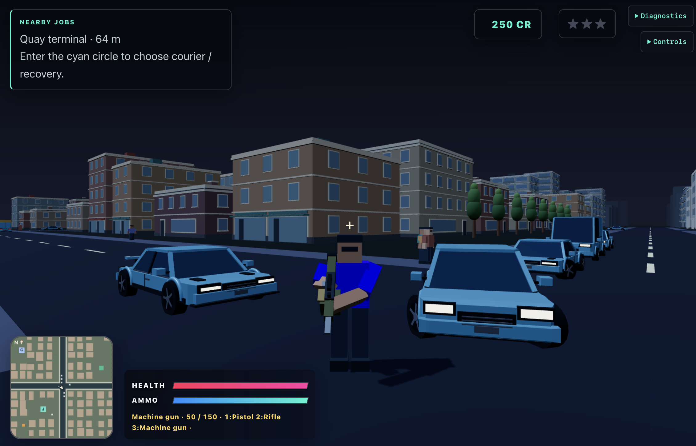

# Port Meridian

Port Meridian is an original third-person multiplayer browser game set in a compact coastal city. Explore on foot or by car, earn credits through jobs, and escape a three-level police response. A Rust server owns gameplay; the TypeScript/Three.js client shares Rust movement code through WebAssembly.

**100% of the code here has been written using a combination of OpenAI Codex agents** (GPT-6 Astra, Sol, Terra), with some high-level interventions by hand to keep the architecture and abstractions under control. This project was developed to <ins>test the performance of [net crate](https://github.com/harveynw/net-crate)</ins>, which handles reliable and unreliable communication between the server and the browser.

## Features

- One authoritative world with a **64-connection limit** and a **768 × 768 m** city across six districts.
- Walking, sprinting, jumping, third-person camera and three arcade vehicle classes: compact, van and sport.
- Courier deliveries, ordered checkpoint time trials and secured-vehicle recovery jobs; saved credits and paid vehicle repairs.
- Ambient traffic and pedestrians, witnessed crimes, police pursuit/search, arrests and safe respawns.
- Pistol, rifle and machine gun with finite ammunition, reloading, NPC and vehicle damage, and on-foot PvP with spawn protection and respawns. Players spawn with all three weapons.
- Original procedural scenery, articulated characters, synthesized sound, a city map and minimap with white dots for other online players, remappable controls, quality settings and reduced motion.
- Local prediction and reconciliation, interpolated remote actors, interest-managed replication and compact diagnostics with performance captures.
- SQLite guest profiles retain committed credits and completed jobs across restarts; each server launch creates a fresh world.

## Run locally

Install **Node 24**, Rustup and the pinned tools:

```sh
rustup toolchain install 1.95.0 --profile minimal --component rustfmt,clippy --target wasm32-unknown-unknown
cargo +1.95.0 install wasm-bindgen-cli --version 0.2.129 --locked
npm ci
npm run dev:all
```

Open [localhost:5173](http://localhost:5173/) after `[ready]` appears, choose **Play**, then **Resume / mouse look**. Ctrl+C stops the supervised server and frontend. For the production client use `npm run preview:local` and [localhost:4173](http://localhost:4173/). The launcher checks real HTTP, WebSocket and WebRTC communication and reports occupied ports without taking them over.

Normal saves live in `var/profiles.sqlite`. For isolated testing, use `npm run preview:local -- --temporary` with a separate/private browser context. Two tabs sharing a guest cookie replace one another; use separate contexts or profiles for simultaneous players. Keep the same hostname and browser context to return to saved progress. See [operations](docs/operations.md) for configuration, startup probes and shutdown.

## Playing

WASD/arrows move or drive, Shift sprints, Space jumps or applies the handbrake, and E enters/exits cars. RMB/Q aims, left click/X fires and R reloads. Select the pistol, rifle or machine gun with 1/2/3 or the mouse wheel. F opens job choices at a cyan terminal or repairs a stopped car in the green Ironworks zone. M opens the map; Esc opens the menu while the world continues. If mouse capture is declined, drag the scene to look. Controls can be remapped in the menu.

Start at the cyan Quay terminal for courier or recovery work. Courier contracts pay 120–220 credits depending on the assigned destination, recovery pays 250, and the north city ring time trial pays 200. Repairs cost 50. The [gameplay guide](docs/gameplay.md) describes locations, conditions, timers and police rules.

## Documentation

| Guide | Contents |
|---|---|
| [Gameplay](docs/gameplay.md) | Features, controls, vehicles, jobs, damage, population, police and presentation |
| [Architecture](docs/architecture.md) | Crates, browser modules, ownership, threads and tick flow |
| [Protocol](docs/protocol.md) | Rust/TypeScript contracts, MessagePack, generation and trust boundaries |
| [Networking](docs/networking.md) | Admission, channels, replication, queues, rates and lifecycle |
| [Simulation](docs/simulation.md) | Shared motors, WASM bridge, collision, prediction and reconciliation |
| [Content](docs/content.md) | City authoring, validation, immutable packages, streaming and budgets |
| [Persistence](docs/persistence.md) | Guest identities, transactional rewards, repair compensation and saves |
| [Operations](docs/operations.md) | Setup, local launch, configuration, probes and diagnostics |
| [Testing](docs/testing.md) | Automated checks, manual verification, evidence and compatibility coverage |
| [Performance](docs/performance.md) | Targets, instrumentation, measured results and unqualified limits |
| [Decisions](docs/decisions.md) | Architectural choices, dependency pins and deployment boundaries |
| [Module diagrams](docs/diagrams/README.md) | Frontend and backend Mermaid diagrams |
| [Asset provenance](content/ASSET-LICENSES.md) | Original procedural art and sound sources |

These guides describe the implemented game. The owning code, generated contracts and frozen fixtures define exact executable behavior; update affected guides and diagrams when changing it.

## Verification and support

`npm run check` verifies generated outputs, WASM, types, lint/formatting and Rust/TypeScript tests. `npm run build` produces the client and native artifacts. Socket/process tests run explicitly as described in [testing](docs/testing.md).

Localhost is the default development setup. Local gameplay is verified with the in-app Chromium browser, including two guests, driving deliveries, police escape and saved rewards across restarts. The broader browser matrix remains unverified. Process supervision is verified on macOS; Linux is unverified and Windows supervision is unsupported. Target-network performance, reference-hardware budgets and sustained memory stability remain **unqualified**; the [performance guide](docs/performance.md) records the measured limits.
