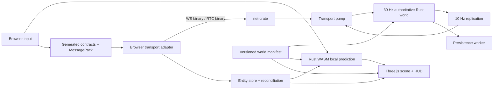

# 03 — Architecture

[Index](../README.md)

The [current module diagrams](diagrams/README.md) map the implemented frontend and backend through T18. Keep their Mermaid sources in sync with architecture changes; the proposed layout below includes later milestones.

## Stack and ownership

| Layer | Choice | Responsibility |
|---|---|---|
| Browser app | TypeScript strict mode, Vite, Three.js WebGL2 | Rendering, input, UI, audio, interpolation, local prediction |
| Browser simulation | `sim-core` Rust compiled via `wasm-bindgen`/`wasm-pack` | Same movement/collision code as native server |
| Authoritative game | Rust stable, fixed-step single simulation thread | State, validation, gameplay, NPCs, rewards |
| Transport | Pinned `net` Git dependency | WebSocket signalling/reliable binary and WebRTC unordered binary |
| Wire format | Serde + `rmp-serde`; `@msgpack/msgpack` | MessagePack map encoding |
| Contract generation | `ts-rs` + `schemars`; Ajv 2020 in browser | TS declarations and runtime structural validation |
| Collision | `rapier3d` behind our `CollisionWorld` | Static shape casts/raycasts and shared collision queries |
| HTTP control plane | Axum on a separate async runtime/thread | Health, guest session, join tickets, build metadata |
| Persistence | SQLite, one persistence worker | Guest profiles and idempotent economic transactions |
| Assets | glTF/GLB, small texture atlases, authored JSON compiled into a manifest | City visuals and shared gameplay content |
| Testing | Rust tests, Vitest, Playwright, scripted load client | Contracts, simulation, actual two-transport browser flow |

Pin compatible versions and commit Cargo/npm lockfiles in task T01. Only the net-crate revision is fixed by this document. Do not copy invented “latest” version numbers into manifests. Verify native and WASM builds together before settling the physics version.

Three.js is a renderer, not the source of collision or game rules. Rust is the source of movement behavior, not the source of camera or animation. Do not add a second JavaScript physics engine.

## Runtime layout



One process hosts one shard. Up to 16 players connect to that process. There is no distributed world, cross-server bus, or microservice architecture.

Threads:

1. **net-crate internal thread:** owned by the dependency.
2. **Transport pump:** dedicated synchronous thread calling the crate API, draining events, decoding bounded messages, and exchanging bounded queues with simulation.
3. **Simulation main thread:** sole owner of mutable world state; never awaits sockets, database, disk, or HTTP.
4. **HTTP async thread/runtime:** owns the control-plane listener and ticket issuance.
5. **Persistence worker:** owns SQLite connection and transactions.

The transport pump isolates `blocking_send` from simulation, but does not make the crate’s internal queues safe. Additional hardening is mandatory only for a future public release; fix any concrete issue that blocks the current local load target.

The browser starts on one main thread. WASM is called synchronously for short fixed steps. A Web Worker is a measured future optimization, not a prerequisite; no SharedArrayBuffer or cross-origin isolation requirement in alpha.

## Proposed repository

```text
Cargo.toml                       Rust workspace
Cargo.lock
rust-toolchain.toml
package.json                     npm workspaces, unified scripts
package-lock.json
crates/
  protocol/                      DTOs, wire limits, errors, semantic validators
  content/                       Rust content types and content validator
  sim-core/                      vectors, motors, collision, control state
  sim-wasm/                      wasm-bindgen adapter only
  server/
    src/{main,config,world,tick}.rs
    src/net/{adapter,session,replication}.rs
    src/gameplay/{vehicles,combat,npcs,police,missions}.rs
    src/{http,persistence,metrics}.rs
  xtask/                         codegen, content bake, fixture generation
apps/
  client/
    src/{main,app}.ts
    src/{net,simulation,world,render,input,ui,audio,content}/
packages/
  protocol/src/generated/        committed generated TS + JSON Schemas
  protocol/src/{codec,validate}.ts
  sim-wasm/                      generated wasm-pack package; build artifact
content/
  source/                        authored world/gameplay JSON
  assets/                        original or licensed source models
  licenses/                      asset attribution and provenance
  generated/                     immutable compiled world package
tests/
  fixtures/protocol/              cross-language positive/negative fixtures
  scenarios/                     deterministic gameplay scenarios
  browser/                       Playwright tests
  load/                          actual-net-crate synthetic clients
ops/                             proxy/container examples and runbooks
docs/                            this design
```

Directories above are proposed; do not claim they exist until implemented. Keep the reference checkout outside this repository. Depend on the pinned Git commit; never make a developer’s absolute path a shipped dependency.

## Dependency rules

```text
protocol -> serde, rmp-serde, ts-rs, schemars; optional native jsonschema codec
content -> protocol's primitive types only (or its own content DTOs)
sim-core -> protocol's control/state DTOs, content, rapier3d
sim-wasm -> sim-core, protocol, wasm-bindgen
server -> protocol, content, sim-core, net, axum, SQLite adapter
xtask -> protocol, content
client -> generated protocol, sim-wasm, Three.js
```

`protocol` must not depend on the server, physics engine, rendering library, or transport crate. No `usize`, physics handles, socket IDs, database rows, or Three.js classes cross the wire. All time values and coordinate conventions are explicit.

`sim-core` must build without networking, filesystem, OS clock, random thread-local state, or database access. Time and seed are parameters. Entity iteration must have a stable order. Use a small world store with typed IDs and explicit system functions; an ECS framework is unnecessary for the initial counts.

## Authority and data flow

- Browser sends intent: controls, action requests, readiness, heartbeat. Never an authoritative position, velocity, health, reward, hit result, or seat grant.
- Server validates identity and state, runs one fixed step, then publishes snapshots and reliable results.
- Browser keeps separate authoritative replicas and local predicted state. Rendering reads a presentation model; it cannot mutate a replica.
- The server’s content manifest hash is required at join. A mismatched collision/content package refuses entry and offers reload.
- A guest profile ID, shard entity ID, transport peer ID, and local render object ID are four different things. Never use a crate peer ID as an entity or account identity.

## Cross-cutting identifiers

Wire IDs use `u32`, scoped by a random `world_id` string for the current shard lifetime. Entity IDs increase monotonically and are not reused in that lifetime. Rotate the shard before counters approach exhaustion. Long-lived profile and mission-instance IDs are opaque UUID strings. No Rust `u64` silently converted to JavaScript `number`.

Session state is discarded on disconnect. Reconnect creates a new connection and player entity, restores only committed profile values, and requires a fresh baseline. No assumption that a reused `net` peer ID means the same player.

## Build and configuration

The implementation must expose:

```text
npm run dev                 client dev server
cargo run -p server -- --config config/dev.toml
npm run build               codegen + WASM + content + client production build
cargo run -p xtask -- generate
cargo run -p xtask -- check-generated
cargo run -p xtask -- bake-content
npm run check               TS + lint + generated drift + unit tests
cargo test --workspace
npm run test:e2e
```

Scripts must be documented when introduced. `generate` is explicit, reproducible, and writes only generated paths. `check-generated` compares a temporary regeneration with committed outputs and never overwrites work silently.

Slice config selects loopback addresses, memory persistence, two players, and debug overlays. Full local-alpha config selects local SQLite, loopback origins, limits, and 16 players. Public hosting configuration is deferred. Secrets stay in environment variables or protected runtime files, not frontend bundles.
