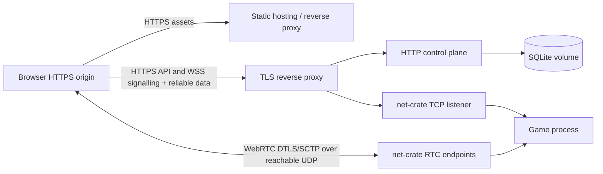

# 16 — Optional future public hosting

[Index](../README.md) · Dependency constraints: [net-crate integration](04-net-crate-integration.md)

**Deferred reference only.** The user selected localhost deployment. Nothing in this document is a required implementation task or completion gate for the local game. Use [Local deployment](12-deployment-and-operations.md) now. Revisit this appendix only if public hosting is requested later.

## Development topology

```text
Browser at http://localhost:5173
  -> Vite assets
  -> dev proxy /api -> HTTP control plane 127.0.0.1:3001
  -> ws://127.0.0.1:3000 -> net-crate
  -> RTC host candidate on 127.0.0.1:<ephemeral UDP port>
```

The networking crate uses ephemeral UDP per peer. Do not configure a fake fixed UDP 3000 mapping. Loopback proof is the first step; use explicit actual host addresses for LAN tests and inspect the advertised candidates.

Local configuration fields:

```toml
[server]
net_bind = "127.0.0.1:3000"
http_bind = "127.0.0.1:3001"
max_players = 2
world_seed = 12345
content_manifest = "content/generated/manifest.json"

[auth]
allowed_origins = ["http://localhost:5173"]
secure_cookie = false # Development only; true behind HTTPS.

[persistence]
mode = "memory"       # "sqlite" for save/restart testing
path = "var/profiles.sqlite"

[limits]
max_input_batches_per_second = 60
max_actions_per_second = 10
```

RTC bind/advertise/port-range configuration is **not available in the pinned crate**. Add supported fields only after the upstream hardening task defines them. Do not put fictional options into a runnable release config.

## Intended public topology



Use one region and one long-lived Linux process for the alpha. Containerization is optional; a systemd-managed binary is sufficient. Standard static-only hosting/serverless HTTP functions cannot host this game server’s long-lived RTC transport.

The TLS proxy secures WebSocket signalling/reliable traffic. It does **not** relay WebRTC merely because `/net` proxies successfully. RTC needs reachable ICE candidates and UDP connectivity independently.

Public networking work must establish one tested option:

- Preferred: a host with a public routable address plus supported configurable UDP range/advertised candidates in net-crate.
- If NAT or restricted networks require relay: verify underlying library TURN support and credentials/candidate behavior in a separate spike, then document and provision it.

Do not bind only loopback behind a reverse proxy and assume public browser RTC will work. Do not assume a Docker TCP port mapping maps RTC ports. If restricted-network support is unavailable, show a clear connection failure; do not invent a WebSocket fallback. Adding fallback requires a separate crate/session design.

## Reverse proxy and hosting requirements

Proxy routes:

| Path | Target | Notes |
|---|---|---|
| `/`, `/assets/*`, `/world/<hash>/*` | static client/content | Immutable content-hashed assets |
| `/api/*` | HTTP control plane | Same origin; no credential wildcard CORS |
| `/net` | net-crate TCP listener | WebSocket Upgrade, long read timeout, origin/admission controls |
| `/health/*` | control plane | Expose only needed health checks |
| `/metrics` | private control plane | Never public unauthenticated |

Serve `index.html` with short/no cache; content-hashed JS/WASM/world assets with immutable cache. A single build ID maps to a single protocol/content/sim hash set. Preserve old immutable assets during rollout so a partially loaded old page does not receive mismatched files; old sessions may be rejected and asked to reload.

Use HTTPS/WSS, explicit origins, HSTS after validating the domain, and a restrictive CSP allowing only intended assets/connect endpoints. Set correct WASM MIME type. Do not add cross-origin isolation unless a later worker design requires it.

## Resource and abuse controls

Start at 16 authenticated players, at most 24 combined loading/active reservations, 32 total negotiating connections, and a 15-second transport negotiation timeout. The baseline crate lacks all required early limits, so these release values depend on hardening.

- Limit upgrades and join-ticket issuance per source; account for shared NATs when choosing deployment thresholds.
- Cap text signalling at 64 KiB/frame, 256 KiB total per negotiation, 128 ICE candidate messages, and one expected answer. These are policies to implement in the transport layer.
- Cap game frames, decoder structure, per-session action/input rate, queues, and work as in document 05.
- Validate all requests before allocating expensive gameplay state.
- Use cryptographic randomness for cookies/tickets, seeded reproducible randomness only for world/NPC behavior.
- Do not log cookies, tickets, raw SDP, raw binary payloads, or full user identifiers. Use abbreviated random correlation IDs.
- Run as an unprivileged user with a writable state directory only. Keep dependency lockfiles and asset licenses.

The server is authoritative against impossible movement and fabricated rewards. It does not prevent client-side wallhacks, aim assistance, or abuse through valid actions; PvP is out of scope. Do not describe alpha as cheat-proof.

## Persistence and backup

Use SQLite WAL mode with one writer and bounded busy timeout. Migrations run before ready; migration failure stops startup. Store database on a persistent local disk/volume, not an ephemeral container layer.

Back up using SQLite’s online backup API or an equivalent consistent snapshot procedure, not an arbitrary copy of the database while ignoring WAL files. Daily backup is sufficient for alpha; retain seven and test restore. This is a deployment recommendation, not a request to schedule an automation now.

Crash recovery: re-open database, run integrity/migration checks, load content, issue a new world ID, start empty world, restore profiles on join. Economic event uniqueness prevents replayed worker transactions from duplicating money. Active missions are not resumed.

## Observability and alerts

Structured logs include build ID, world ID, tick, redacted session correlation, event kind, and reason. Record metrics named in document 11. Suggested operator triggers:

- Tick p99 > 33 ms for 1 minute.
- Reliable queue overflow or repeated actor failure.
- Join success below 90% excluding invalid tickets/version mismatch.
- Persistence failures or queue latency > 2 seconds.
- Sustained RSS growth during soak.

Expose separate live/ready statuses. A process with a dead transport thread is not ready. The transport probe must exercise a complete data-channel handshake periodically at low frequency or consume a hardened crate readiness/health API.

## Release and rollback

1. Run contract, simulation, browser, gameplay, and generated-drift checks.
2. Build server/client/WASM/content from one revision and record hashes.
3. Run capacity and cross-network transport gates against a staging host.
4. Back up persistent state and verify migration compatibility.
5. Stop issuing tickets, mark not-ready, notify players, drain in-flight transactions.
6. Deploy server and static entry point; retain immutable previous assets.
7. Probe HTTP, WSS, actual RTC, two-player movement, and profile save/rejoin.
8. Mark ready and resume ticket issuance.

If probe fails, restore the previous binary/static entry point and a compatible database. Avoid destructive schema migrations in alpha; if a migration is not backward compatible, plan restoration and data loss explicitly before release. No “zero downtime” claim for a single shard.

## Operator runbooks

**WSS works but game never opens:** inspect selected ICE candidates, actual bind/advertise IP, UDP firewall/NAT, and negotiated channel. Do not debug this as MessagePack first.

**Players see rubber-banding:** inspect tick load, late input rate, input lead, RTT/jitter, collision/content hashes, and correction histogram. Do not increase server trust in client transforms.

**Cars/players disappear:** inspect visibility lifecycle IDs and interest caps; absence in one snapshot is not a despawn signal.

**Cash duplicated or lost:** inspect economic event ID and transaction commit; never manually replay a reward with a new ID.

**Actor panic/queue overflow:** remove readiness, capture bounded diagnostics, close affected sessions, and fix the transport path before public traffic resumes.
