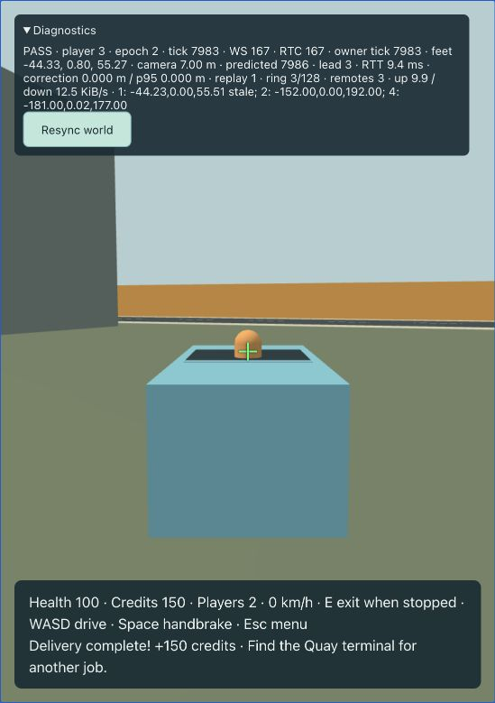
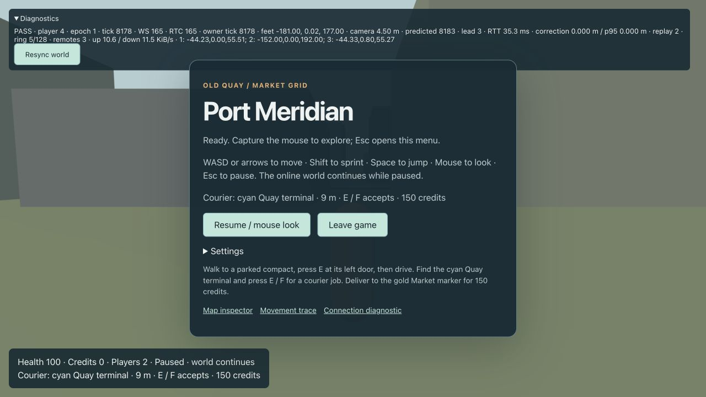
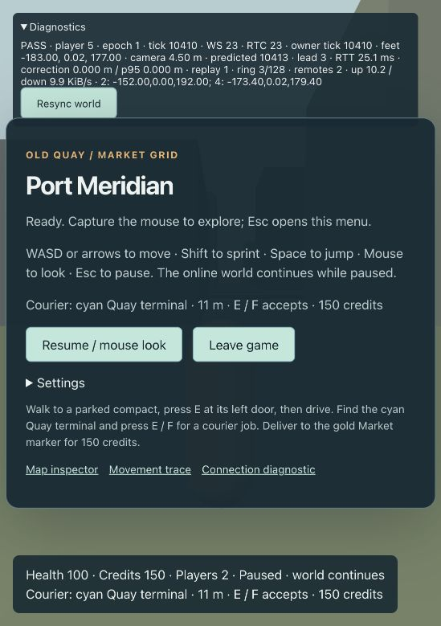

# 25 — Courier playable slice

[Index](../README.md) · [Task plan](13-implementation-plan.md) · [Implementation evidence](implementation-log.md)

T11 completes the first multiplayer gameplay loop: two independent guests, shared movement and driving, a private courier job and one committed reward. All art remains greybox. This is the G2 slice milestone; the broader alpha and population/performance gates remain later work.

## Run and play

Use Node 24.19.0 and the pinned Rust toolchain. Run:

```sh
npm ci
npm run check
npm run build
npm run dev
```

In a second terminal:

```sh
cargo run -p server --locked
```

Open [the game](http://localhost:5173/), choose Play and Resume / mouse look. WASD moves, Shift sprints, Space jumps, and E enters/exits a car. Drag the scene to look if pointer lock is declined. While driving, WASD controls throttle/steering and held Space overrides throttle and applies the handbrake.

1. Find the cyan pole/ring at Quay, near the spawn plaza, centered at `[-172, 0, 180]`. The HUD shows terminal distance. Approach within 3 m and press F. On foot E also accepts when no car takes interaction priority. The job pays 150 credits and lasts 180 seconds.
2. Walk to a compact's left door and press E. Follow the gold ground route along the roads to the gold Market pole/ring at `[-44, 0, 52]`. The validated road route avoids the Market landmark north of the destination; do not drive straight through buildings toward the pole.
3. Stop within 5 m of the destination for one continuous second at speed below 2 m/s. Hold Space to stop even if W/S is still down. Delivery also works on foot. Leaving the ring or moving too fast resets the dwell.
4. The HUD confirms **Delivery complete! +150 credits** only after the server commits the reward. The completion/failure view clears after five seconds. To abandon a job, open Esc and choose Cancel courier. Cancellation/timeout/death/arrest/disconnect/controlled-car destruction do not reward.

The timer and online world continue in menus and through resync. Jobs belong to individual players; accompanying guests do not share rewards or private mission status. Leaving abandons an active job. Rejoining the same guest retains committed credits while the server process runs; restarting the memory server clears profiles and credits.

## Recorded two-guest demonstration

Verified on 21 October 2026 using real net-crate WS + RTC, development at `localhost:5173` and production preview at `127.0.0.1:4173`. For the second guest, keep the dev client/server running, then run:

```sh
npm run preview --workspace @port-meridian/client -- --host 127.0.0.1
```

The distinct hostnames provide independent guest cookies. Two tabs on the same hostname intentionally replace one another.

The runner, player 3, accepted `courier_quay_market` near `[-172.89, 0.02, 179.62]` at approximately tick 3468, entered compact 1 (epoch 1 → 2), and drove to Market. The final car center was `[-44.23, 0, 55.51]`, within 5 m of the authored destination. After braking and continuous dwell, the HUD showed 150 credits and completion at tick 7980; elapsed observation time was about 150 seconds, within the 180-second deadline. The driver stayed in the car.



The production observer, player 4, independently received the same car center and seated driver position `[-44.33, 0.80, 55.27]`. Its private balance stayed zero and its HUD showed no active courier.



The runner left and rejoined as player 5. The new baseline showed exactly 150 credits, no active mission and the normal spawn. Separately, player 4 accepted its own courier at Quay, cancelled through the menu, received failure/cancellation feedback and remained at zero credits.



## Authority, lifecycle and bounds

`missions.rs` owns the courier lifecycle; `world.rs` applies actions in existing stable peer order, evaluates authoritative character/car motion after simulation, and publishes owner-only status. A mission has an opaque server-generated instance ID, immutable destination/configuration, deadline and bounded dwell counter. Cancel/death/arrest/vehicle invalidation precede timeout, which precedes success. Resync retains the mission, resets interrupted dwell and keeps its original deadline.

The memory profile adapter atomically records `mission:<instance_id>`, credits and completed-job count. Repeating an identical event returns committed values; conflicting profile/amount reuse fails without mutation. Completion is published only after commit. An internal pending reward prevents another acceptance and retries the same event if the adapter refuses a commit. There are at most 16 live session missions, 256 memory profiles and 4,096 retained reward events per server process; reaching the event cap requires restarting the memory server. T17 introduces durable storage and its operational recovery behavior.

The existing wire DTOs already include accept/cancel, MissionView and PlayerStatus; no wire schema or content hash changed. Status revisions advance on mission/economy changes, with the existing one-second reliable repair heartbeat. Public replicas never contain another player's mission or balance. The destination is a private coordinate marker rather than a new replicated entity.

Client code owns guidance and visual markers only. It never submits a position, elapsed dwell, completion or reward. Gold route geometry comes from the baked road graph; terminal/target visuals do not add collision. Teardown disposes marker geometry/materials with the scene.

## Verification and limits

`npm run check` passes 187 TypeScript tests and 78 Rust tests, generated drift, release WASM packaging, type checking, lint, formatting and Clippy. `npm run build` passes with the existing large Three.js chunk warning.

New regressions cover acceptance range, duplicate request caching, one active job, private status/revisions, resync continuity, on-foot/driving completion, continuous dwell reset, excessive speed, cancel/timeout/death/disconnect precedence, reward idempotency/conflicts/bounds, five-second view cleanup and retained profile values after rejoin. Client regressions cover F key edges/pause cleanup and countdown/success/failure guidance. Tests use server-controlled fixture placement for boundary scenarios; the live demonstration above used ordinary keyboard driving without teleporting or injecting completion.

Timeout/death boundary cases are automated; the live pair demonstrated normal delivery, cancellation, privacy and rejoin. No 16-player soak, live network impairment, production persistence, traffic, police, combat or full city is claimed. T12 remains unstarted; stop at this playable slice for review.
