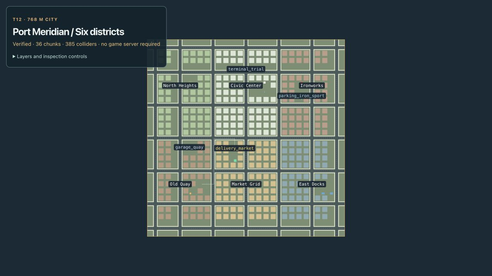
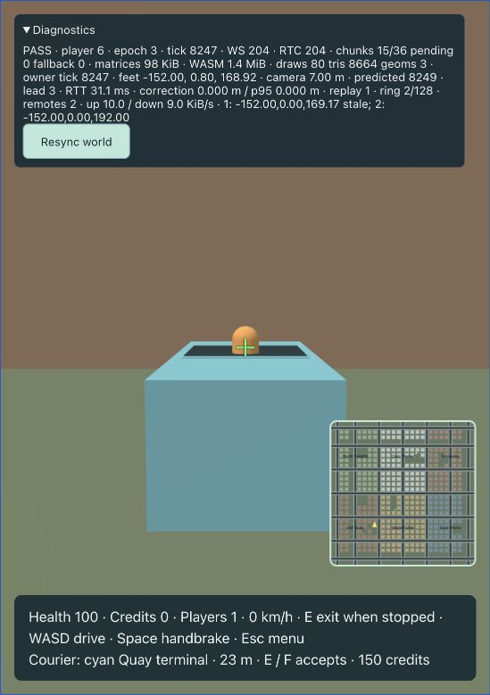

# Full city and content kit — T12

The live game and `/map` now use `content/source/city.json`: a 768 × 768 m city, six districts and 36 deterministic 128 m visual chunks. `content/source/slice.json` remains a separate regression fixture, including its old boundary and saved simulation traces. Run the client and server as described in the README; the server selects the full-city index before accepting players.

North Heights, Civic Center and Ironworks occupy the northern row; Old Quay, Market Grid and East Docks occupy the southern row. District palettes distinguish buildings. Primary streets cross at −256, −128, 0, 128 and 256 m; the ring is at ±352 m. The full map removes the temporary slice boundary. It retains the Quay courier and adds Civic spawn/terminal access, a trial start, repair zone, recovery lot and eight unique reserved recovery slots. Reserved cars are data for T16 and do not spawn as public vehicles. Time-trial and recovery templates validate but are not playable jobs yet.

Four public cars cover compact, van and sport templates. Server movement, local prediction, entry prompts, seat positions and camera height resolve the actual template. The van's taller driving view avoids its body blocking the road. Space retains brake priority over W/S, including a held accelerator.

Landmarks include the original water tower, Market canopy and garage beacon, plus a Civic clock, Ironworks chimney, dock cranes and Heights pavilion. A simple distant hill and ocean form the outside backdrop. All are original procedural boxes; [asset provenance](../content/ASSET-LICENSES.md) records the sources. These remain greybox assets.

## Loading and ownership

The browser verifies the package index, manifest, schema, reference paths and SHA-256 asset hashes. All 385 static colliders, simulation configuration, debug data, vehicle art, backdrop and baked minimap load before Ready. Gameplay initially loads its spawn visual chunk; the standalone inspector loads all chunks. Physics is never removed by visual streaming.

`ChunkStream` requests detail within 192 m of a chunk's horizontal bounds, retains it through 256 m, caps simultaneous requests at four, and caps detailed residents at 24. Distance orders requests. Each request has an eight-second timeout; bootstrap transfers retry twice, while streamed transfers retry twice with short backoff. Obsolete transfers abort. A failed chunk uses its coarse backdrop until it leaves the keep radius; re-entry permits a fresh attempt. Cancellation and disposal prevent late callbacks from resurrecting graphics.

The renderer batches chunk primitives by color/layer into instanced meshes. Removing a chunk disposes its instance buffers and reveals clipped coarse backdrop geometry. Shared box geometry and fixed palette materials live until renderer disposal. Session teardown aborts pending work and disposes retained chunks and renderer resources. No chunk owns simulation state. A 384 px baked map supplies the 256 px HUD canvas, showing district labels, the player and private mission target.

## Verification and budgets

`npm run check` passes 194 TypeScript and 83 Rust tests, including generated drift, release WASM, strict typing, lint/formatting and Clippy. `npm run build` passes; Vite retains its existing large-chunk advisory. Original slice traces remain unchanged.

The full-city native test samples **17,818** road, sidewalk and access positions at intervals of at most 4 m, checking capsule clearance and floor support. All three vehicle motors run against the full collision set without loading visual chunks. A continuous compact drive completes all four ring corners over **7,478 ticks / 2,780.3 m**. Vision queries from major intersections reach five distinct landmarks. Content validation checks connected road/pedestrian graphs, access reservations, road-supported trial checkpoints and eight unique recovery slots; malformed fixtures fail. Stream tests cover concurrency, load/keep radii, cancellation, disposal, two retries and stable fallback. Loader tests reject corrupt distant visuals and verify complete physics at streamed startup. Camera and prediction tests cover template selection and van height.

The live development browser traversed Quay → Market Grid → Civic Center, crossing the former slice boundary and moving beyond the initial chunk's keep radius. It showed 14–18 detailed residents, no settled pending/failed requests, 94–114 KiB of instance matrices and 1.4 MiB of WASM memory. A Civic van entered successfully, reached 17 km/h and stopped under Space. That run exposed the camera obstruction, subsequently fixed and covered by a camera regression. It preceded the final hill/pavilion decoration change. Final-package admission, minimap and map overview were checked again. In the final package, the compact reached **25 km/h** and stopped at **0 km/h while W + Space remained held**, The forward parking approach also has a building ahead, so a second clear-space check reversed to 25 km/h and stopped under held S + Space at car center [−152.00, 0.00, 169.17], well before the next parked car at Z = 192. Both runs had real WS/RTC receipts and displayed correction p95 0.000 m. This is local verification, not an impairment or population benchmark.

Run `npm run build`, then `npm run content:audit -- docs/evidence/t12-budgets.json` to regenerate the [machine-readable report](evidence/t12-budgets.json). Byte counts below describe the current package; gzip is computed per file with Node zlib, rather than inferred from development-server traffic.

| Resource | Recorded value | Planned ceiling |
|---|---:|---:|
| Full city assets, 45 files | 666,200 B raw / 62,477 B gzip | 60 MiB compressed |
| Initial content, including root index | 327,048 B raw / 31,221 B gzip | Part of first play |
| All production JS/CSS/WASM plus HTML | 689,958 B gzip | Part of first play |
| Conservative first play, including all build code | 721,179 B gzip | 12 MiB compressed |
| Complete static collision | 41,461 B | 2 MiB |
| Worst retained chunk instance matrices, fallback plus 24 largest chunks | 146,944 B | Within 256 MiB graphics budget |
| Minimap canvas pixels | 851,968 B | Within 256 MiB graphics budget |
| Live WASM linear memory | 1.4 MiB | Observed separately |

The report conservatively counts all production code chunks even though routes load lazily. Matrix storage has CPU and GPU copies; counting both plus minimap pixels remains under 1.1 MiB. These are managed-buffer bounds, not a measurement of total browser heap or driver memory. The fixed box/palette, actor geometry and browser overhead are additional. Full memory profiling, frame-rate gates, 16-player capacity and a ten-minute soak remain T20. Traffic and pedestrians are T13; no ambient population is implemented here.
