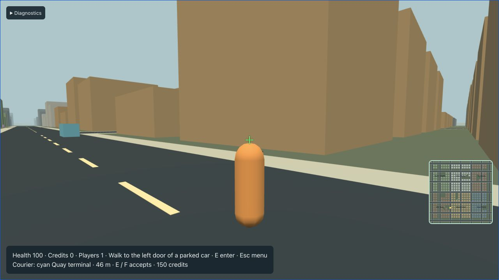

# Ambient traffic and pedestrians — T13

The full-city server owns ambient actors through `population.rs`. Start the server and browser using the [README](../README.md), choose Play, and open Diagnostics to see locally relevant pedestrian/car counts. Purple capsules distinguish pedestrians from turquoise remote players. Actors continue moving while the menu is open.

## Population and ownership

The director runs once per second. There are at most **24 traffic cars**, **32 pedestrians**, and **24 parked-pool slots**, eight of which are reserved for future recovery jobs. The current city has four authored public parked cars and eight recovery reservations; it does not fill unused parking slots with arbitrary roadside cars. Initial content exceeding the ordinary parked or recovery budget fails startup.

A car retains its pool tag through parking, player entry, exit, and disconnect. A parked former traffic car consumes a traffic slot. Occupied traffic cars are pinned, and their AI never overrides player controls. Empty traffic cars become eligible for recycling after 30 seconds beyond 220 m from every playing guest. Parked authored cars remain at their authored homes until driven. Recovery reservations do not spawn cars in T13.

New ambient actors must be 40–160 m from playing guests, clear of every guest's 40 m radius, and occluded from every guest by static vision blockers. Visibility checks test body and head heights. This uses authoritative player eye positions; it is deliberately conservative and does not receive or trust a reported camera/frustum. Candidates come from spaced interior positions of authored lane/sidewalk segments. Cars require 12 m separation and a clear complete vehicle footprint; pedestrians require clear character capsules and 3 m separation. A bounded candidate scan leaves unavailable slots empty instead of spawning visibly or overlapping actors.

Despawn and stuck recovery also require occlusion. Removing visual chunks never removes authoritative actors or physics. Runtime IDs increase monotonically, and ordinary AOI hide/show generations handle retirement and re-entry.

## Driving and walking

Traffic decisions run at 5 Hz. Directed lane routes use shortest travel-time paths; a shared FIFO processes at most four path jobs per tick, and each car may request at most two per second. Route failure stops the car and retries. Progress below 2 m for five seconds requests a new route; after fifteen seconds a hidden unowned stuck actor may recycle. Visible actors are never teleported.

All car controls feed the existing 30 Hz vehicle motor with each actual vehicle template. A per-tick proportional throttle servo follows the last decision's speed target, bounded at 12 m/s; turns slow to 4 m/s. Three front rays brake for static/car obstacles within `max(4, speed × 1.5)` m. Separate sensors yield to pedestrians and guests without applying damage. Motor sweeps remain the final collision authority.

Nearby lane corners share an intersection reservation. The first request wins; world iteration orders same-tick requests by entity ID. Reservations expire after four seconds, release on departure/despawn, and cause losing cars to brake. There are no cosmetic signals claiming to control traffic.

After thirty seconds, a traffic car passing a free authored public parking spot may reserve it and approach using its motor. Within 2 m at less than 0.3 m/s it becomes Available and its AI driver disappears logically. AI cars remain unavailable for entry while Driving, Yielding, Stopped, or Parking, including when stopped at an intersection. Parking does not create a new entity or transfer pools.

Pedestrians follow sidewalk and explicitly authored crossing edges at 1.4 m/s, with occasional one-second waits. They check traffic before entering crossings and finish a crossing once committed, while cars yield. Their controls use the same character motor without jump input. Stuck hidden pedestrians can recycle after fifteen seconds. A graph-bound five-second, 4 m/s flee hook is ready for authoritative shot/impact observations; T13 has no weapon or damage producer. Incapacitation/damage lifecycle belongs to T14.

## Verification and limits

Automated tests cover full-cap traversal between districts, clearance after every shared motor step, hidden/ranged spawning, 30-second retirement, occupied pinning, pool identity, eight reserved parking slots, deterministic seeds, reservation expiry/release, obstacle braking, no-path stopping, parking availability, authored crossings, and flee expiry. A world integration test exercises NPC descriptors and snapshots through the real protocol codec, rejects taking an AI car, then confirms player driving and disconnect after availability. A real WASM regression covers interpolated traffic proxies turning across ±π, keeping shortest-arc yaw inside the bridge contract.

The seeded traversal runs 2,100 ticks (70 simulated seconds) and then empties the world through the ordinary director. It reaches 24 traffic / 32 pedestrian caps. This is a deterministic correctness test, not a real-time performance or 16-player capacity benchmark.

Presentation remains greybox. Traffic uses simple waypoint steering, conservative braking, and hidden stuck recovery; it does not implement overtaking, signal phases, complex avoidance, or visible forcible carjacking. Player/vehicle/pedestrian damage, police and crime observations are later milestones. Browser rendering uses existing interpolation and full independent snapshots; at high local density the configured replication budget can drop snapshots, so the oldest overdue records receive priority. Both application and transport snapshot budgets reserve 64 KiB of their existing 120 KiB burst allowance for lifecycle/baseline messages; the rate remains 60 KiB/s. A saturated populated-world regression verifies a complete resync and return to play. Failed reliable sends retire the queued session tail rather than emitting an incomplete baseline. Full populated capacity, frame profiling and target impairment remain T19/T20.

Current validation: `npm run check` passes **195 TypeScript / 92 Rust tests**, plus generated drift, typing, lint/format and Clippy. `npm run build` produces the native server, release WASM and production client; the existing large Three.js chunk advisory remains. The [seeded population transcript](evidence/t13-population-test.txt) records the full-cap run, including 50 traffic actors moving more than 20 m during successive populations.

The final production session completed two populated resyncs without replacing its player, advancing epochs 1 → 2 → 3. [Saved diagnostics](evidence/t13-live-diagnostics.txt) show real WS/RTC receipts and the final control epoch; this is a local correctness sample, not a capacity claim.

