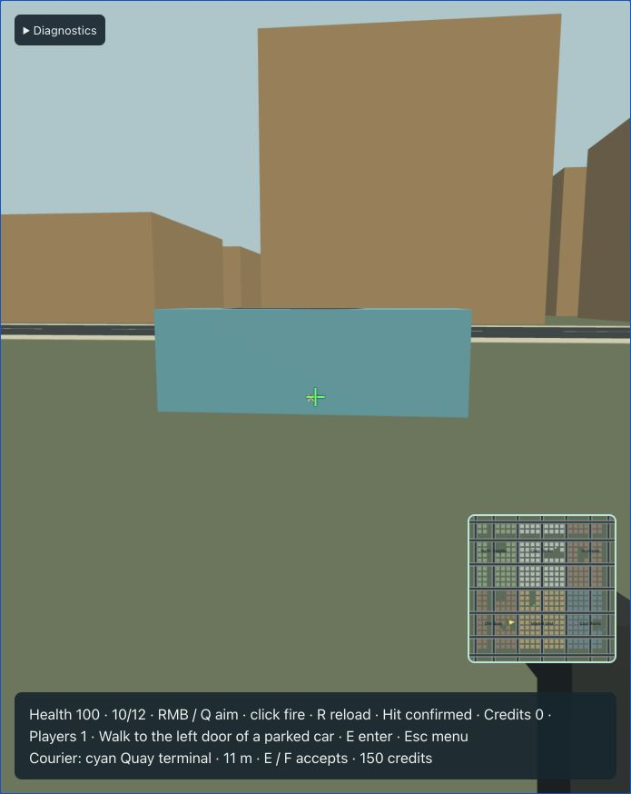
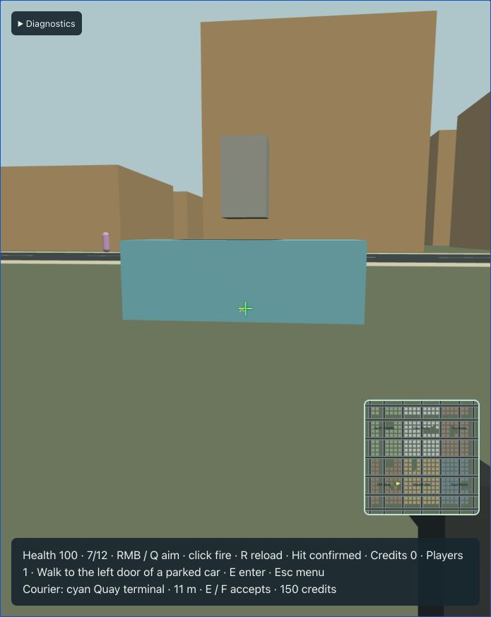

# Pistol, impacts and downing — T14

Run the server and production browser using the [README](../README.md). On foot, hold **right mouse** to aim, or press **Q** to toggle aim for keyboard/drag-look use. Click left mouse once per shot; **R** reloads. Menus, blur, hidden tabs and control changes clear weapon input. Driving disables firing. Aim uses a simple first-person view and original procedural pistol; the HUD shows authoritative ammunition, reload, protection and respawn state.

## Authority and hit rules

The server owns a 12-round magazine, a nine-tick fire cooldown and a 45-tick reload. Action request IDs use the existing idempotency cache; duplicates return their original result and cannot spend another round or apply another hit. Stale control epochs, loading/downed players, empty magazines and active reloads reject. Entering a vehicle or becoming downed cancels reload. A three-second spawn-protection timer starts on initial readiness/respawn and ends on firing, entry or job acceptance.

Fire uses the authoritative feet position plus 1.45 m, bounded request yaw/pitch and an 80 m ray. The chest-to-muzzle portion is included in collision testing, so a wall cannot be bypassed by placing the muzzle past it. Static vision blockers and the ground stop shots. Exact upright vehicle boxes and character capsules determine the nearest damage target; players are excluded from ray absorption and damage. A pistol hit applies 25 damage. An occupied car belonging to another guest blocks the ray but takes no damage from the shooter, preventing indirect PvP through vehicle destruction.

Successful shots produce one reliable Shot event for nearby guests and the shooter. The client bounds event deduplication and pools 32 short-lived tracer/impact effects. Gold hit feedback appears only when the authoritative Shot names a damaged entity. Private PlayerStatus publishes actual ammunition and reload deadlines. Damaged/disabled vehicles and incapacitated pedestrians use existing replicated health/mode fields; no wire DTO changes were needed.

## Impacts and lifecycle

The shared vehicle motor reports impact speed loss and contacts. Contacts now distinguish static collider IDs from dynamic vehicle IDs, which occupy different namespaces. Static/car impact damage is `clamp((delta_speed - 6) × 5, 0, 50)` once per counterpart per 15 ticks. Car-to-car contacts evaluate both cars, with player-caused damage to another guest's occupied car suppressed. Impacts never target player capsules.

Vehicle/pedestrian queries sweep the actual box against the hit capsule using relative motion and both bounded endpoint yaw poses. A cheap swept broad-phase rejects distant pairs before shape casts. Above 4 m/s, an impact applies `min(100, speed × 8)` damage once per pair per 15 ticks. Intended pedestrian motion is recorded before vehicle movement and collision recovery follows damage detection; otherwise physical recovery could erase the hit before it was observed. Nearby shot/impact observations activate the T13 graph-bound flee behavior.

At zero health pedestrians become non-graphic, non-controlling incapacitated actors for 300 ticks, then leave the population and free their slot. The director cannot prematurely retire them during this interval. Disabled vehicles stop and remain in their population pool. They return after 900 ticks at a clear compatible home parking slot, retry every 30 ticks while blocked, and consider other compatible authored slots after 30 blocked retries. Ordinary parked cars retain their authored home; traffic cars choose a compatible authored parking home. Occupied or recovery-reserved positions are not valid car respawns. A guest or pedestrian within 6 m of a candidate defers the respawn.

Fatal vehicle damage clears the driver, tests each door against static/cars and other actors, then falls back to the nearest eligible safe spawn. The player becomes Downed with no vehicle ownership and a fresh reliable control epoch, pending input is cleared, reload is canceled and an active job fails. After 150 ticks the server selects a clear supported spawn, restores 100 health/full magazine and emits another control epoch. Credits/profile identity remain unchanged. If no safe exit or spawn exists, the zero-health occupied car freezes and retries; it is marked disabled only after clearing its driver, preserving the protocol's disabled/occupancy invariant. Respawn also waits for space rather than inserting a capsule into geometry.

## Verification

`npm run check` passes **197 TypeScript / 102 Rust tests** including generated drift, release WASM, strict typing, lint/format and Clippy. `npm run build` passes; the existing Three.js bundle-size advisory remains.

Eight new world scenarios cross the real wire codec: duplicate/cooldown/ammo/reload rules and cancellation on entry; player-transparent shots and occupied-car protection; fatal crash/job cancellation/control epochs/player and car respawn; wall occlusion and ten-second pedestrian incapacitation; per-counterpart crash cooldowns; symmetric car damage and no-PvP contacts; actual world pedestrian impact ordering; and blocked parking respawn. Two shared-query tests cover ray volumes/range/rotation and swept contacts/near misses. Client tests cover weapon edge/focus cleanup and agreement between the aim camera and authoritative ray direction. The original movement/vehicle traces and T13 population checks remain passing.

This is greybox combat. Police, crime/heat, arrest and additional jobs remain later milestones; there is no explosion damage, lag compensation, additional weapon or remote detailed aiming pose. Audio and polished animations remain T18. Capacity/impairment profiling remains T19/T20.

The final production browser used ordinary controls to fire, reload, confirm four hits on an unoccupied compact and disable it. Its nearby entry prompt then rejected use until a clear parking respawn. After the guest moved clear, the car returned with 100 health and accepted entry/exit again. Crash/respawn and pedestrian cases are covered by native fixtures rather than claimed as live demonstrations.

