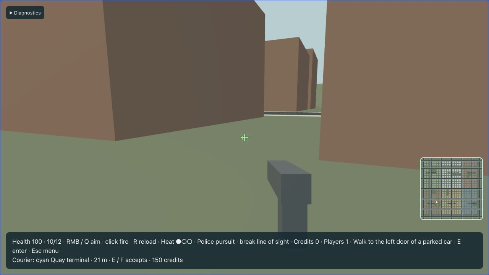
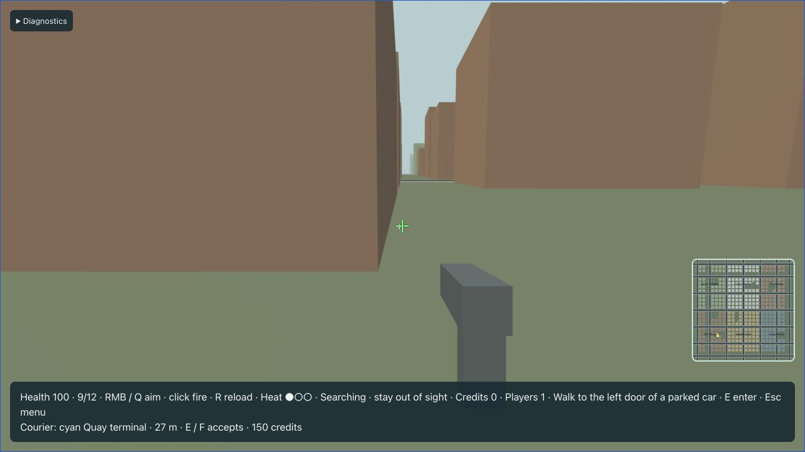
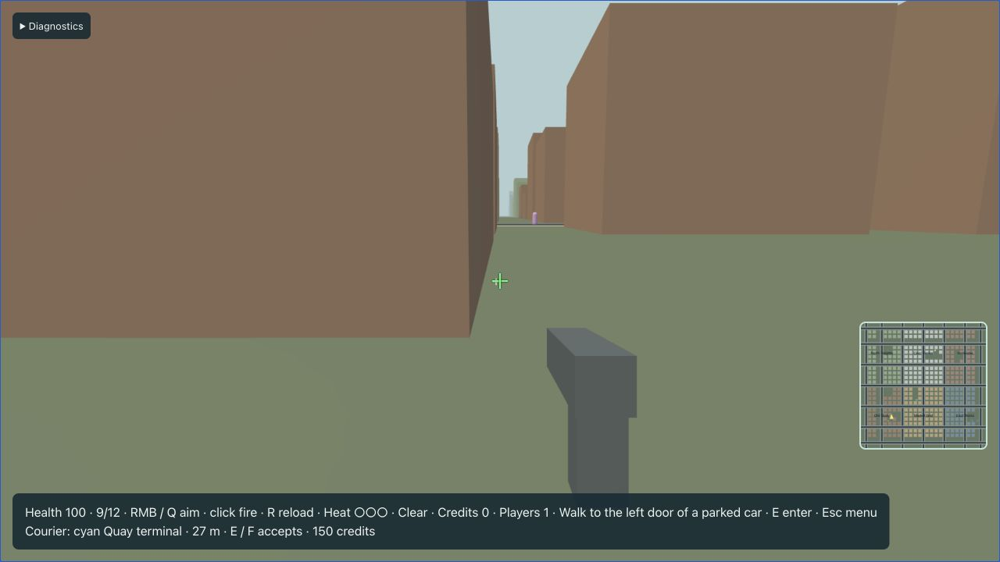

# Police and heat — T15

Run the production client and server using the [README](../README.md). Police use compact cars with blue roof beacons. The HUD shows three heat pips and Clear, Pursuing, Searching or arrest feedback. The second Quay compact is secured; its entry prompt warns about police witnesses. Public unmarked cars remain freely available. Police cars cannot be possessed. The server keeps the secured tag with the car after it moves and publishes its warning label through the existing descriptor display name.

## Server observations and private heat

Only successful server actions and damage create crimes. A secured theft requires a police witness within 50 m and static line of sight. Pistol shots can be heard within 80 m through walls. Pedestrian harm requires a police witness within 60 m and sight of the harm. A damaged police car reports its own hit, including a fatal hit. Shooting and damage caused by the same shot share a causal ID, as do multiple pedestrian/contact observations from one car impact tick. Multiple witnesses cannot multiply heat.

A bounded per-tick observation map and 64-entry per-player causal history deduplicate observations. Heat increases at most once per 30 ticks, clamps to three, and each fresh witnessed crime refreshes last-known position/time even during the increase cooldown. Heat/pursuit are sent only in the owning player's existing PlayerStatus. No network contract changes were needed.

Sight runs at 5 Hz, through static vision blockers, within 70 m of the player or occupied car. After 150 ticks without sight the state becomes Searching. Units navigate to the last observed point; the hidden player's live position does not update their destination. After 600 search ticks without sight or a new crime, heat drops one level. Further levels each require another 600 ticks. Sight or a new witnessed crime resumes pursuit and restarts these timers.

## Units, navigation and bounds

The full city starts with two patrols, on Old Quay and Civic Center road loops. The small slice remains an unchanged regression fixture. Police occupy their own eight-unit budget and never consume parked, traffic or recovery slots. Heat requests one, two or three pursuing units. Assignment gives each wanted player one unit before additional units and rotates its first recipient every five seconds under contention. A 16-player fixture verifies eventual service without exceeding eight units.

Police reuse the shared directed road navigation and compact motor. Steering decisions run at 5 Hz, path requests at at most 2 Hz per unit; up to eight police planning jobs can run in one turn, separately from the four-job ambient FIFO. Close direct steering is allowed only within 15 m after a full vehicle-shape sweep verifies a drivable approach. Physical cars, players and pedestrians cause braking. No-path cases stop rather than cross static geometry. Police neither shoot nor damage player capsules.

Reinforcements must be at least 40 m from every playing guest, statically occluded from all of them, collision-clear and within 180 m of their assignment. Blocked candidates leave capacity unfilled. Stuck units replan; after 15 seconds without 2 m of progress they can be recycled only when hidden from every guest. Surplus units also retire only while hidden. Wrecks remain for at least three seconds and until hidden, then free their unit slot. Visible cars never teleport. Original flat motors and waypoint steering remain greybox behavior.

## Arrest and recovery

An assigned live unit's front anchor must stay within 3 m, with static line of sight, while the player or occupied car moves below 0.5 m/s. Conditions are checked every simulation tick and must hold continuously for 90 ticks. Movement, obstruction or a missing unit resets progress. The HUD estimates progress from the latest authoritative Arresting transition; only ControlChanged confirms an arrest.

Arrest releases vehicle possession through the existing actor-aware door/nearest supported safe-spawn search. Controls and reload stop, the active mission fails, heat/assignments clear and the owner receives a fresh reliable control epoch. If all safe exits are blocked, controls freeze and the server retries without creating an actor inside geometry. After 150 ticks, safe respawn restores health, ammunition and protection with another epoch. Credits are retained. Reconnect and downing also clear heat and police targets. Browser prediction freezes arrested/downed characters even with movement held.

## Verification and limits

`npm run check` and `npm run build` are the final verification commands. Focused tests cover causal deduplication/cooldown, exact search/decay and reacquisition timers, continuous arrest/reset, witness range/static occlusion/acoustics, fatal police self-reporting, collision-safe patrol motion, private heat and reconnect cleanup, unseen escape, secured theft, police seat rejection, mission failure/credits/respawn, driver ejection/stale epochs and 16-player fair cap allocation. Release WASM tests exercise disabled-owner prediction and respawn recovery. Every world scenario crosses the real outbound codec.

Live production evidence uses the actual WS/RTC server and ordinary keyboard/mouse controls. A shot raised heat to one; movement behind Quay buildings changed Pursuing to Searching, then heat returned to zero after staying hidden. Native fixtures arrange positions explicitly for precise arrest, witness and capacity boundary checks. The 16-player fixture is not a real RTC capacity benchmark. Audio, detailed police art and on-foot officers are not part of this milestone; real impairment and full capacity/memory profiling remain T19/T20.

