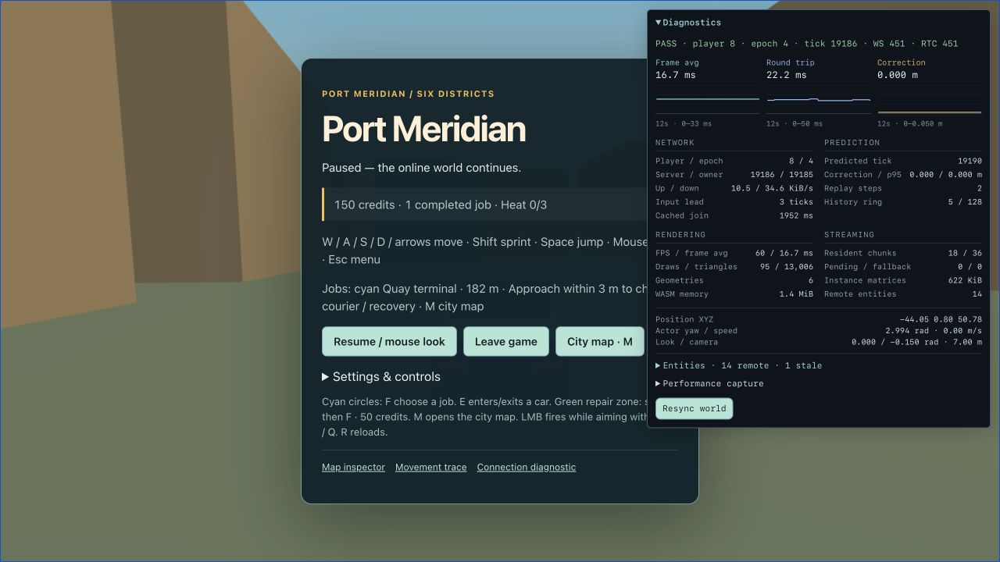
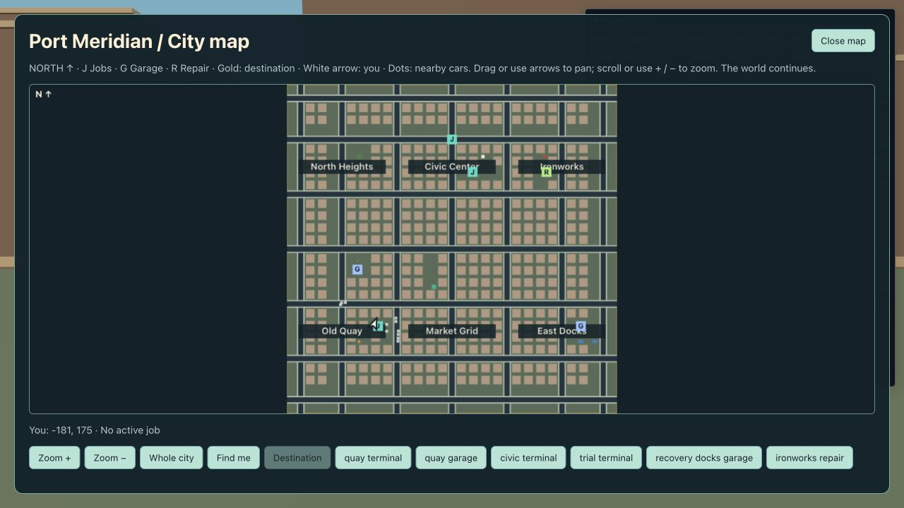

# 38 — Local acceptance and handoff

**T22 local functional acceptance completed, 25 October 2026.** G0/G1/G2/G3/G5 have local functional evidence; **G4 is deferred, not passed**, following the user's explicit request to revisit network performance and their net crate later. This is a handoff of the tested localhost alpha, not a claim of target-network performance or a qualified multi-browser release.

## Start and stop

Use Node 24, Rust 1.94.0 with rustfmt/Clippy/the WASM target, and wasm-bindgen-cli 0.2.129. [37 — Local launch](37-local-launch.md) gives explicit prerequisites and troubleshooting.

```sh
npm ci
npm run dev:all          # http://localhost:5173, Vite development
# or
npm run preview:local    # http://localhost:4173, production bundle
```

Each combined command builds, supervises Rust/Vite, checks the proxy and real WS/RTC receipts, and prints `[ready]`. Stop it with Ctrl+C; it flushes SQLite and stops its owned listeners. Stop any existing manually launched server/preview before starting another. `npm run setup` only prepares artifacts; `--no-build` explicitly reuses them after setup. `--temporary` creates isolated test saves in a printed directory; use a private/separate browser context to preserve the cookie identifying your normal guest. Never delete saves to resolve an occupied port.

Normal saves are **`var/profiles.sqlite`**, configured by `config/dev.toml`. Credits and completed jobs survive reconnect/restart; position, car control, active mission and heat do not. The page hostname and browser context identify a guest through its HttpOnly cookie. Two tabs on the same hostname intentionally replace one guest; use independent normal/private contexts or the documented `localhost` / `127.0.0.1` cookie-scope split for two players. The startup probe has a separate cached identity and leaves before readiness is announced.

Play, then Resume. WASD/arrows move; Shift sprints; Space jumps/handbrakes; E enters/exits; F opens jobs/repair; Q/RMB aims; X/LMB fires; R reloads; M opens the map; Esc opens the menu. The online world continues in menus. Courier starts in the cyan Quay circle at **[-172, 0, 180]**, pays **150 credits**, and ends in the Market ring at **[-44, 0, 52]**. Stop inside the ring for a continuous second. Follow roads around buildings; a human-readable test route is Quay parking → [-128,176] → [-128,0] → [-44,0] → Market. Use the M map for the time trial, recovery garage and repair zone.

## Tested build and environment

- Network **v3**, build **`protocol-simple-local`**, city seed **424242**, content **`a322579fa1fedb5e3c058552fa96bcc8e22e0b21a36098b883b6cc35741c9939`**, SQLite schema migration **1**.
- net-crate remains pinned to **`77b401b1376b5c8bcb98da2884efcb1e63082ba4`**; no networking fork, codec change, delta protocol or authority bypass was introduced.
- macOS 14.5 arm64 / Apple M1 Pro, Node **24.22.1**, npm **10.9.2**, Rust **1.94.0**, wasm-bindgen-cli **0.2.129**.
- Approved browser automation: in-app Chromium reporting **Chrome/156.0.0.0**, **1280 × 720**, DPR **2**. Medium quality was explicitly inspected for guest B. Guest A retained its existing presentation preferences. [Recorded browser scope](evidence/t22-environment.json).

## Production gameplay acceptance

The tests used the production frontend and actual release Rust/net-crate server with an isolated SQLite database. Two browser tabs used distinct hostname cookie scopes: A on `localhost:4173`, B on `127.0.0.1:4173`. Inputs were ordinary browser buttons/keyboard controls. The driving checks steered with WASD/Space against visible diagnostic pose/heading, never by setting positions, actor state, heat or rewards. Native fixtures remain separate boundary tests.

| Acceptance scenario | Current evidence |
|---|---|
| Server starts with the authored seed; real readiness | Supervised production build and restart each obtained complete admission/baseline/StartPlay and nonce-matched WS + RTC receipts before reporting ready |
| Two guests and matching content | A **8**, B **65**, each saw exactly one replica of the other; both completed verified package admission on the same world |
| Movement replication | A moved from X **−183.00 → −172.40 m**; B's interpolated replica showed X **−172.6 m** in the sampled frame |
| Exclusive compact possession | A entered compact **1**, epoch **1 → 2**; B stayed on foot and saw **Vehicle occupied**. Native simultaneous-entry tests cover atomic same-tick contention |
| Released-car handoff | A exited to epoch **3**; B entered the same compact at epoch **2**. B's seated pose was **[-152.10, 0.80, 183.73]**. This handoff was exercised before the courier drive rather than transporting B to Market afterward |
| Courier by driving | A took back the compact at epoch **4**, drove the road/driveway route and stopped at seated pose **[-44.05, 0.80, 50.78]**, speed **0**. The HUD showed **Delivery complete! +150 credits** and **1 completed job**; B stayed at zero. The timer still showed 46 seconds immediately before final dwell |
| Reconnect/cleanup | Rejoining A became entity **217**, epoch **1**, on foot at the spawn, with **150 credits**, one completed job and no active job/heat. A's next nearby departure removed that replica from B's table |
| Real shutdown | Both browsers displayed interrupted-connection/Retry feedback. Ctrl+C flushed persistence and released 3000/3001/4173 |
| Full process restart | New world, same test SQLite/cookies: A restored **150 / 1**, B **0 / 0**. Read-only SQLite inspection before and after restarts found exactly **one `mission` event for 150**, with no duplicate reward |
| Police/crime/privacy | A's nearby shot spent one round (**12 → 11**) and produced **one heat pip / Pursuit**; B remained clear. Retreat to **[-215.23, 0.02, 191.87]** led to **Searching**, then **zero heat / Clear** while unseen, retaining 150 credits |
| Presentation/audio/camera | Medium map pan/zoom/find/whole-city controls worked. Visible sound status changed **Sound paused → Sound on → Sound paused** through Resume/Esc. Third-person driving used 7 m follow distance; a nearby wall shortened the aiming camera to 0.10 m rather than putting it through geometry. Subjective audio mix was not assessed |

The browser observations, steering trace and intermediate samples are [recorded here](evidence/t22-browser-acceptance.json). [Read-only reward persistence checks](evidence/t22-persistence.json) cover both the original restart and the restart with the patrol fix. Full startup/shutdown logs: [initial production build](evidence/t22-preview.txt), [restart](evidence/t22-restart.txt), [corrected release restart](evidence/t22-fixed-restart.txt).





Police sequence: [witnessed shot](evidence/t22-police-pursuit.png), [unseen searching](evidence/t22-police-search.png), [heat cleared](evidence/t22-police-escape.png). A separate later out-of-hearing shot correctly spent ammunition without heat; shots are not automatic crimes regardless of witnesses.

## Issue found and repaired

Acceptance exposed a patrol replacement bug. Home selection used the current unit count's parity: if Quay retired while Civic remained, replacing the missing unit selected Civic again. Repeated replacements could remove Quay coverage despite retaining two police units.

`police.rs` now chooses the less-represented home district when allocating a replacement. Existing hidden/collision-safe spawn, cap, pursuit and authority rules stay in place. A new regression retires alternating patrols through six replacement cycles and requires one Quay and one Civic home after every cycle. It **failed on the previous code** (Quay count 0 instead of 1) and passes with the correction. [Before](evidence/t22-patrol-before.txt), [after](evidence/t22-patrol-after.txt). The production witnessed-shot/search/escape sequence above was repeated on the corrected release build.

Diagnostics now also display **Actor yaw / speed** alongside pose/look/camera. This separates actual character/vehicle heading from camera input when checking driving and stopping. It is ordinary read-only telemetry, with no test-only mutation interface.

## Gate and task review

| Gate | Handoff status |
|---|---|
| G0 contracts | Native/WASM builds, generation drift and cross-language protocol/content/bridge checks pass |
| G1 transport | Actual browser WS/RTC plus native startup probes pass; pinned dependencies unchanged |
| G2 courier slice | Two distinct guests, replicated movement, exclusive car possession, handoff, real driving delivery and committed reward verified |
| G3 alpha mechanics | Live police/search/escape and presentation checks plus the full combat/population/jobs/repair/persistence scenario suite pass. Trial/recovery/repair boundary completions are native scenarios, not additional T22 live browser runs |
| G4 capacity/performance | **Deferred by user; unverified/failed metrics retained in [36](36-capacity-and-performance.md). Not a pass** |
| G5 local handoff | One-command dev/production launch, real readiness, save/restart, owned-process cleanup and runbook verified |

T01–T19 and T21 are complete. T22's local functional handoff is complete within the user-authorized sequencing decision; T20 remains deferred. This does not certify all G0–G5 as passed. Prior milestone evidence remains dated and scoped rather than being presented as newly repeated tests.

## Checks and remaining limits

The final captured checks are linked below after execution. Reproduce with:

```sh
npm run check
npm run test:local
cargo test -p server --example local_probe --locked
npm run build
```

Network latency/throughput, RTC queue freshness, 60-minute soak, reference-hardware budgets and full memory profiling remain the deferred T20 work. Native Chrome access was not approved for this session; standalone Chrome, Edge, Firefox and Safari were not exercised here. The in-app Chromium result does not qualify that broader browser matrix. Native pointer-lock acceptance, forced WebGL restoration and a subjective audible-mix review retain their existing verification limits; drag-look is verified. The procedural low-poly art and synthesized effects are the implemented local alpha presentation.

Public/LAN hosting, TLS, STUN/TURN and public-network hardening remain the future appendix, outside the localhost delivery scope. No cloud, domain, payment, telemetry service or public listener was added. Normal saved play is restored after testing; the isolated acceptance database is retained for inspection and is not merged into normal guest saves.

Final verification: **111 TypeScript / 138 workspace Rust tests pass**, including the new patrol replacement regression, generated drift, release WASM, typing, lint/format and Clippy over all targets. **Seven explicit launcher/process tests** and **two startup-probe example tests** also pass. The production build passes with the existing Three.js chunk-size advisory. [Full check](evidence/t22-check.txt), [build](evidence/t22-build.txt), [launcher suite](evidence/t22-launcher-tests.txt), [probe examples](evidence/t22-probe-tests.txt). The final normal-save preview again obtained real startup receipts: [normal startup](evidence/t22-normal-startup.txt).
