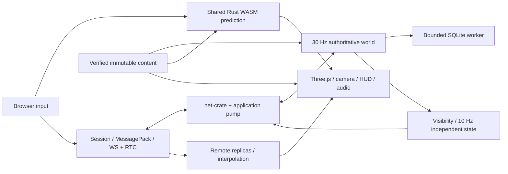

# Architecture and ownership

[Documentation index](../README.md#documentation) · [Module diagrams](diagrams/README.md)

The Rust server owns the world. The browser sends input and action intent, predicts only its controlled actor through the same Rust motor compiled to WebAssembly, and renders authoritative replicas. One server process hosts one world of at most sixteen players. There is no distributed service layer or shared-local-storage multiplayer.

## Rust workspace

| Crate | Responsibility |
|---|---|
| [`protocol`](../crates/protocol/src/lib.rs) | Rust-owned network DTOs, scalar/input invariants, MessagePack codecs, shared limits and fixture/code-generation metadata |
| [`content`](../crates/content/src/lib.rs) | Content/config DTOs, canonical hashing, geometry/reference validation, deterministic baking and navigation data |
| [`sim-core`](../crates/sim-core/src/lib.rs) | Fixed-step character/vehicle motors, Rapier collision world, moving vehicle proxies and gameplay query geometry; no networking, rewards or rendering |
| [`sim-wasm`](../crates/sim-wasm/src/lib.rs) | wasm-bindgen lifetime/API wrapper and local MessagePack contracts exposing shared prediction and static queries |
| [`server`](../crates/server/src/lib.rs) | Admission, authoritative simulation, replication, vehicles/population/combat/police/jobs/repair, SQLite persistence, HTTP control and metrics |
| [`xtask`](../crates/xtask/src/main.rs) | Deterministic protocol/content/bridge generation, baked packages and recorded native traces |

## Browser and shared packages

`apps/client/src/game/app.ts` orchestrates lifecycle, input, rendering, camera, HUD, map, settings, audio and diagnostics. `net/session.ts` owns admission, scope, baselines, clock, actions and local prediction; `net/transport.ts` owns WS/RTC signalling and pressure handling. `world/replica.ts` owns visibility identity and interpolation. `simulation/bridge.ts` owns WASM allocation and byte calls; `simulation/prediction.ts` owns replay/history/smoothing. `render/`, `ui/`, `input/`, `audio/` and `content/` own their respective presentation/tools.

`packages/protocol` supplies generated TS/Schema metadata and the thin MessagePack codec. `packages/content` supplies generated contracts, verified loading, routing and visual streaming. `packages/bridge/tests` exercises the real release WASM boundary. `packages/sim-wasm` is generated build output, not authored source.

## Stack

| Boundary | Implementation |
|---|---|
| Presentation | Strict TypeScript, Three.js WebGL2, Vite, DOM/canvas UI, WebAudio |
| Shared simulation | Rust, Rapier/Parry queries, wasm-bindgen; no JavaScript physics engine |
| Game transport | Pinned `harveynw/net-crate`: reliable binary WebSocket and unordered, no-retransmit WebRTC game channel |
| Serialization | Rust Serde + `rmp-serde`, browser `@msgpack/msgpack`, named maps |
| Contract generation | Rust `ts-rs` and `schemars`; network schemas are metadata, content/local-bridge schemas are validated |
| HTTP control | `tiny_http` on a separate thread; Vite proxies `/api` and `/health` |
| Saves | `rusqlite` with bundled SQLite, one worker/connection, WAL and transactional migration/recovery |
| Assets | Authored JSON plus deterministic procedural/baked primitives, instanced rendering and runtime synthesized effects |

Exact versions are in [Cargo.toml](../Cargo.toml), crate manifests, [package.json](../package.json) and both lockfiles. Rust is pinned to 1.94.0; wasm-bindgen CLI matches 0.2.129.

## Threads and state

1. The simulation main thread is the sole owner of mutable gameplay state and advances fixed 1/30 s ticks. It never awaits sockets or a database result.
2. The application transport pump alone calls the net-crate server handle. It exchanges bounded queues with the world and isolates dependency blocking sends from simulation.
3. net-crate owns its internal actors/runtime. Their queues and numeric event identity limitations are separate from our application bounds.
4. The HTTP thread serves guest/session/ticket/health/metrics operations through shared control state.
5. The persistence worker owns the SQLite connection and transactions. The world submits nonblocking work and polls committed results.

The scheduler permits at most five fixed steps per poll, discards excess wall-time backlog rather than changing physics DT/skipping simulation ticks, and reports sustained overload. The launcher supervises a release server and Vite in owned POSIX process groups; the native startup probe is a short-lived separate process.

## Server module boundaries

`main/config/scheduler` handle startup, persistence selection and timing. `world` owns sessions, stable event ordering and authoritative transitions. `transport/replication` own connection generations, queue bounds, budgets, spatial relevance and packet packing. `admission/control` own local guests, tickets and cached control-plane status. `population/vehicles/combat/police/missions/jobs/repairs` implement the rules in [gameplay](gameplay.md). `persistence` implements saves; `performance` holds bounded histograms.

Each tick polls storage and drains transport events, removes closed/expired sessions, handles peer-ordered messages and completes committed admission. It selects the next tick's owner inputs, runs police/population directors, advances shared motors in stable entity order, resolves impacts/combat/police, then advances repairs and missions. Visibility changes are synchronized before owner/snapshot replication and bounded output flushing. Unsafe motor state retires the affected session rather than committing a partial step.

Protocol and shared simulation do not depend on server storage or graphics. Meshes never define collision, health, ownership or mission completion. NPCs feed the same motors as players. Visible chunk removal never changes physics. A client cannot set position, money, damage or heat.

The expanded [frontend](diagrams/frontend.mmd) and [backend](diagrams/backend.mmd) diagrams show actual modules and their calls. Keep diagrams synchronized with ownership, thread and significant data-flow changes.
