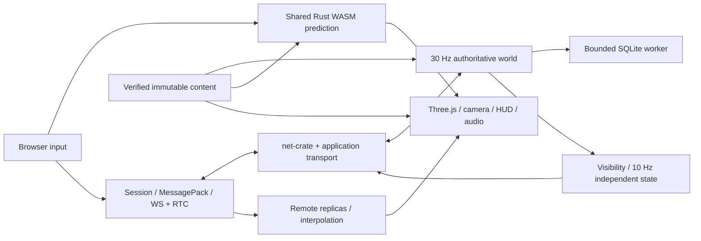

# Architecture and ownership

[Documentation index](../README.md#documentation) · [Module diagrams](diagrams/README.md)

The Rust server owns the world. The browser sends input and action intent, predicts only its controlled actor through the same Rust motor compiled to WebAssembly, and renders authoritative replicas. One server process hosts one world of at most sixteen players. There is no distributed service layer or shared-local-storage multiplayer.

## Rust workspace

| Crate | Responsibility |
|---|---|
| [`protocol`](../crates/protocol/src/lib.rs) | Rust-owned network DTOs, scalar/input invariants, MessagePack codecs, shared limits and fixture/code-generation metadata |
| [`content`](../crates/content/src/lib.rs) | Content/config DTOs, canonical hashing, geometry/reference validation, deterministic baking and navigation data |
| [`sim-core`](../crates/sim-core/src/lib.rs) | Fixed-step character/vehicle motors, Rapier collision world, moving vehicle proxies and gameplay query geometry; no networking, rewards or rendering |
| [`sim-wasm`](../crates/sim-wasm/src/lib.rs) | wasm-bindgen lifetime/API wrapper and local MessagePack contracts exposing shared prediction and static queries |
| [`server`](../crates/server/src/lib.rs) | Admission, authoritative simulation, replication, vehicles/population/combat/police/jobs/repair, SQLite persistence, HTTP control and metrics |
| [`xtask`](../crates/xtask/src/main.rs) | Deterministic protocol/content/bridge generation, baked packages and recorded native traces |

## Browser and shared packages

`apps/client/src/game/app.ts` orchestrates lifecycle, input, rendering, camera, HUD, map, settings, audio and diagnostics. `net/session.ts` owns admission, scope, baselines, clock, actions and local prediction; `net/transport.ts` owns WS/RTC signalling and pressure handling. `world/replica.ts` owns visibility identity and interpolation. `simulation/bridge.ts` owns WASM allocation and byte calls; `simulation/prediction.ts` owns replay/history/smoothing. `render/`, `ui/`, `input/`, `audio/` and `content/` own their respective presentation/tools.

`packages/protocol` supplies generated TS/Schema metadata and the thin MessagePack codec. `packages/content` supplies generated contracts, verified loading, routing and visual streaming. `packages/bridge/tests` exercises the real release WASM boundary. `packages/sim-wasm` is generated build output, not authored source.

## Stack

| Boundary | Implementation |
|---|---|
| Presentation | Strict TypeScript, Three.js WebGL2, Vite, DOM/canvas UI, WebAudio |
| Shared simulation | Rust, Rapier/Parry queries, wasm-bindgen; no JavaScript physics engine |
| Server entity storage / tick execution | Standalone Bevy ECS components with stable game IDs; ordered single-threaded schedule |
| Game transport | Pinned `harveynw/net-crate`: reliable binary WebSocket and unordered, no-retransmit WebRTC game channel |
| Serialization | Rust Serde + `rmp-serde`, browser `@msgpack/msgpack`, named maps |
| Contract generation | Rust `ts-rs` and `schemars`; network schemas are metadata, content/local-bridge schemas are validated |
| HTTP control | `tiny_http` on a separate thread; Vite proxies `/api` and `/health` |
| Saves | `rusqlite` with bundled SQLite, one worker/connection, WAL and transactional migration/recovery |
| Assets | Authored JSON plus deterministic procedural/baked primitives, instanced rendering and runtime synthesized effects |

Exact versions are in [Cargo.toml](../Cargo.toml), crate manifests, [package.json](../package.json) and both lockfiles. Rust is pinned to 1.95.0; wasm-bindgen CLI matches 0.2.129.

## Threads and state

1. The simulation main thread owns gameplay and transport state, polls network events, advances fixed 1/30 s ticks, and flushes outgoing messages. The net crate's blocking sends can stall this thread.
2. net-crate owns its internal actors/runtime. Their queues and numeric event identity limitations are separate from our application bounds.
3. The HTTP thread serves guest/session/ticket/health/metrics operations through shared control state.
4. The persistence worker owns the SQLite connection and transactions. The world submits nonblocking work and polls committed results.

The scheduler permits at most five fixed steps per poll, discards excess wall-time backlog rather than changing physics DT/skipping simulation ticks, and reports sustained overload. The launcher supervises a release server and Vite in owned POSIX process groups; the native startup probe is a short-lived separate process.

## Server module boundaries

`main/config` handle startup, persistence selection and fixed-step scheduling. `world` builds the initial actor state; `tick::TickDriver` owns the actor ECS world, with clock, content, configuration and services installed as individual resources. `sessions` owns connections and admission/control transitions; `tick::TickDriver` sequences the existing gameplay phases through an explicitly ordered Bevy schedule. `transport/replication` own connection generations, queue bounds, budgets, spatial relevance and packet packing. `admission/control` own local guests, tickets and cached control-plane status. `population/vehicles/combat/police/missions/jobs/repairs` implement the rules in [gameplay](gameplay.md). `persistence` implements saves; `performance` holds bounded histograms.

The outer loop polls transport events before its scheduled ticks and flushes bounded output after them. Each tick polls storage and drains transport events, removes closed/expired sessions, handles peer-ordered messages and completes committed admission. It selects the next tick's owner inputs, runs police/population directors, advances shared motors in stable entity order, resolves impacts/combat/police, then advances repairs and missions. Visibility changes are synchronized before owner/snapshot replication. Unsafe motor state retires the affected session rather than committing a partial step.

Protocol and shared simulation do not depend on server storage or graphics. Meshes never define collision, health, ownership or mission completion. NPCs feed the same motors as players. Visible chunk removal never changes physics. A client cannot set position, money, damage or heat.

The expanded [frontend](diagrams/frontend.mmd) and [backend](diagrams/backend.mmd) diagrams show actual modules and their calls. Keep diagrams synchronized with ownership, thread and significant data-flow changes.

## Server ECS ownership

`PreparedWorld` builds the authoritative Bevy world through `ecs/bootstrap.rs`, validates spawn geometry, spawns indexed parking actors, attaches metadata, and runs the native initial police roster before sockets or readiness. `TickDriver` takes ownership of that same world when the transport is ready. There is no nested actor world, Runtime resource, or resource-removal bridge.

Player, vehicle, pedestrian, officer, traffic controller, police unit, wanted, mission, reservation and lifecycle state belong to components. Wire IDs remain `protocol::EntityId`; Bevy entity handles are internal and generational. Indexed spawn/despawn commands update the entity and identity index together. Chained systems apply deferred changes before dependent consumers.

Clock, immutable content/configuration, ID allocation, navigation, deterministic RNG, intersection reservations, crime deduplication, pairwise impact cooldowns and metrics are shared resources. Sessions own connection budgets, scoped input buffers, retry receipts and visibility history. The repair ledger survives actor removal so committed debits can be refunded. Networking, collision and the scoped profile persistence service are owner-thread services. These resources coordinate actors or external work without duplicating authoritative actor state.

The explicit tick order is admission → planning → movement → combat → police → failed peers → repairs → missions → publish → flush. Typed messages connect actions, impacts, crime/noise, death/respawn, control changes, missions/rewards, admission/baselines and disconnections. Packet checkpoints commit state before the next FIFO packet. First-error gating suppresses later phases; tick-local scratch and messages are cleared on return.

Read-only component projections and geometry/replication snapshots exist only for the current invocation. They preserve stable game-ID ordering where it affects simulation outcomes. `diagnostics.rs` reads components/resources without detaching them, returning a bounded HTTP snapshot with detailed metrics once per second. `shutdown.rs` uses the live disconnect consumer, applies actor cleanup, then runs only the repair/persistence drain with its existing deadline. The main loop also attempts this drain after an ordinary loop error.

Production startup, ticks, diagnostics and shutdown now use native ECS access. `World`, `EntityStore`, the aggregate `Systems` bundle and install/unpack helpers remain only under `cfg(test)` for scenario fixtures. `with_gameplay`, the borrowed store variant and `legacy_phase` have been removed.

## Historical migration checkpoints

The sections below record the runnable stages in order. References to temporary adapters or remaining work describe that checkpoint and are superseded by the ownership description above.

Stage 1 removes the nested scheduling world and `Runtime` resource. Clock, identity, entity allocator, content, simulation configuration, metrics, timings, sessions and each gameplay subsystem's bookkeeping are individual ECS resources. Collision and networking remain owner-thread non-send services.

Stage 2 moves player, vehicle and ambient pedestrian motors into native scheduled systems in `systems/movement/motors.rs`. They query actor components and borrow collision/configuration/scratch resources explicitly; vehicle input comes from optional police-unit and traffic components with player input taking precedence. These systems do not borrow the population or police managers, sessions, or the legacy world adapter.

The Movement set chains begin → pedestrian motors → vehicle motors → player motors → impact resolution → pedestrian overlap recovery. Each substep checks the tick outcome, so a failure suppresses later work. Vehicles run in increasing game-ID order and refresh collision proxies after each commit; the self-exclusion filter is cleared on both success and proxy-validation failure. Pedestrian overlap recovery is also a native query and remains after swept-impact damage. Stable iteration and clock-commit placement are retained. Planning/directors and impact gameplay consequences still use the temporary exclusive adapter; converting those cross-subsystem interactions belongs to subsequent stages.

The remaining gameplay phases still use the explicitly transitional `tick_state::with_gameplay` exclusive adapter. It temporarily takes resource values into the old method argument shape and borrows the SAME actor world; it does not clone actors, create another world, or reinsert a runtime container. Resources are restored on normal return and unwind. These legacy functions still declare exclusive world access, and reinserting their resources marks those resources changed; do not depend on resource change detection across this bridge. Subsequent runnable stages should replace these adapters with narrow query/resource systems, then replace cross-subsystem calls with typed messages. These checkpoints do not claim a completed message-driven architecture.

Profile ownership is scoped to each schedule run. The main loop holds the control mutex while the driver temporarily owns the existing `Profiles` value, then restores it before returning success or a normal tick error. Neither profiles nor entities are cloned. Transport polling/flushing, overload/catch-up policy and HTTP status publication stay in the outer loop. Intrinsic vehicle homes, pool membership, damage/recovery bookkeeping, mission state and recovery reservations are named components in `components.rs`. Shared coordination state is held in the separate resources; durable profile ownership remains scoped to the tick. No parallel tick execution is enabled. The [original qualification report](evidence/ecs-migration.md) describes the earlier migration, including historical comparisons; it is not evidence for this subsequent stage. The runnable checkpoints are checked with the server build, gameplay/schedule tests and local startup, without a baseline comparison.

### Stage 3: combat facts and same-tick subscribers

`gameplay_messages.rs` defines Bevy `Message` types `CrimeReported`, `NoiseEmitted`, and `ActorEliminated`. Legacy combat producers write into the actor world's registered `Messages<T>` buffers through a small `EntityStore::write_message` bridge; they no longer call the police crime accumulator, population frighten method, or chat elimination methods. Combat no longer takes a mutable chat manager. Secured-vehicle theft uses the same crime channel to retain causal ordering with combat reports.

Three native `MessageReader` systems independently handle these facts: police aggregates witnessed crimes; population updates pedestrian reactions through a query; chat records and broadcasts elimination announcements. Crime messages capture immutable incident-time visibility evidence and the actor's generational handle. Police retains its bounded 256-key accumulator and strongest-report-per-cause rule; stale actors cannot be revived by delayed reports. Elimination messages capture names and the incident tick, so later lifecycle changes do not invalidate the announcement. At delivery the shooter session has been restored, so it receives the announcement once without a special extra recipient.

Reaction checkpoints follow admission, movement impact processing (before overlap recovery), and combat (before the police phase). Each registered reader runs before the batch is cleared. This explicit checkpoint lifetime is the standalone schedule's message maintenance policy; it does not use Bevy App's automatic two-frame retention. Additional subscribers must be placed before batch retirement. Readers are gated on a healthy tick; buffers are cleared at checkpoints and tick boundaries, including normal failure returns, to prevent stale replay. A failed tick does not roll back already applied gameplay.

Notifications now cross subsystem boundaries through messages. Damage/control transactions, AI planning and several other gameplay phases still use the temporary exclusive adapter; this stage does not claim that every gameplay operation has been decomposed. Protocol `WorldEvent` packets remain a separate client-facing replication format.

### Vehicle impact message checkpoint

Vehicle motors now publish typed `VehicleImpact` messages with the game ID, generational entity, incident tick, speed change and contacts. The Movement schedule runs a dedicated damage consumer after all motors and before notification reactions and pedestrian overlap recovery. Its Bevy `MessageCursor` independently tracks delivery; its temporary collected batch exists only during the invocation, rather than in `MovementFrame`. Damage transactions still use the exclusive gameplay adapter. Stale entity handles and mismatched ticks are rejected.

Previous car and pedestrian positions remain legitimate tick-local snapshots for swept collision calculations and replication. The damage consumer runs even with no contact messages so swept pedestrian checks and disabled-vehicle processing are preserved. Impact messages survive notification checkpoint cleanup and are retired at tick boundaries, including failed ticks; additional impact readers must run before that retirement. This standalone schedule does not rely on automatic App message maintenance.

### Native impact calculation checkpoint

`systems/impact.rs` contains native scheduled vehicle-contact and swept-pedestrian calculation systems. They read actor components and tick snapshots and publish `VehicleContactDamage` / `PedestrianImpactDamage` messages. Neither calculation needs the legacy managers. `ImpactCooldowns` is a persistent ECS resource for 15-tick pair suppression; it is no longer hidden in `CombatSystem`. Damage messages are cleared at tick boundaries alongside motor impact messages, including failed ticks.

Movement now orders motors → contact calculation (clock commit) → contact consequences → swept pedestrian calculation → pedestrian consequences and disabled-vehicle processing → notification readers → overlap recovery. This separation matters because contact consequences can disable a car before the pedestrian sweep. Sweeps still run with no contact messages and retain game-ID order. Calculation leaves health unchanged. Consequence handlers still use the exclusive adapter in this first stage; native health/lifecycle changes and remaining consequence messages are subsequent stages.

### Native impact health checkpoint

Native `apply_vehicle_damage` and `apply_pedestrian_damage` systems now consume calculated damage, mutate actor health/state, and insert `DisabledVehicle` / `Incapacitated` components through Commands. The chained schedule applies deferred inserts before later stages. Insert-if-new preserves the first cleanup deadline. Occupied cars keep their existing damage protections and are stopped at zero health; downstream control cleanup remains responsible for their occupants. Component damage helpers are shared with the still-legacy weapon damage path.

Vehicle hits retain counterpart-before-self ordering. Police evidence is captured after each individual health change using shared snapshot rules, so subsequent fatal hits cannot rewrite earlier evidence. Native producers emit crime/noise notifications and `ImpactApplied` presentation facts. The remaining exclusive impact adapter only broadcasts client impact events and performs player/control consequences via `process_disabled`; it no longer changes impact health. Tick boundaries retire applied-impact messages, including failed ticks.

### Impact consequence message checkpoint

`impact_consequences.rs` replaces the movement phase's impact-specific adapter with native scheduled consumers. `ImpactApplied` feeds client impact presentation using the shared combat event counter and existing unreliable delivery/range rules. A native scan emits `DisabledVehicleOccupant` for currently seated occupants of zero-health cars, including retries when exits remain blocked. Recovery validates entity generations and session ownership, selects a safe exit, updates player/vehicle components and emits `CrashEjected` plus `ControlTransitionRequested`. The mission subscriber fails active missions before the control replication consumer runs. Failed ticks clear these messages along with other tick-local facts.

Blocked recovery preserves occupancy and the original respawn deadline. Successful recovery emits one transition, cancels weapon activity, and marks the car disabled. Native recovery does not depend on the combat, police, or population managers. The general `replication::apply_control_transitions` consumer still uses `tick_state::with_gameplay` to call the existing replica/epoch refresh transaction; this is an explicit remaining legacy replication boundary, not a fully native replication implementation. Legacy weapon/combat paths still call `process_disabled` and are outside this impact checkpoint.

### Completed native impact flow

`replication/control_transitions.rs` replaces the final impact-path bridge with a native `MessageReader<ControlTransitionRequested>` system. It reads actor components and the entity index directly, advances the owner's epoch, clears buffered inputs/weapon trigger, refreshes changed replicas reliably for each existing observer, then sends the owner `ControlChanged`. Only requested entities are materialized. Counter and replica validation happen before transition mutations; stale tick/entity/session identities are ignored. The consumer needs no legacy subsystem managers or exclusive world access.

The scheduled movement/impact chain now runs from native motors through impact calculation, health/lifecycle changes, presentation, occupant recovery, mission failure, control replication, notifications, and overlap recovery without `with_gameplay`. Planning, general weapon/combat behaviour, later respawn processing, other replication callers, and unrelated gameplay phases retain their existing adapters. Completion here refers specifically to the impact flow, not the entire server migration.

### Lifecycle checkpoint: pedestrian expiry

`systems/lifecycle/mod.rs` now owns pedestrian expiry as a native ECS system. The Combat phase explicitly chains officer damage → pedestrian expiry → remaining weapon/respawn/vehicle work → orphaned-incapacitation cleanup → notification readers. This retains the prior cleanup point. Chained Commands are applied before dependent systems; indexed despawn removes the actual Bevy entity, all attached components, and its matching game-ID entry together. Generational identity checks protect replacement actors from stale deferred deletions. Orphan metadata cleanup preserves actors with unrelated components and removes identity-only shells.

Existing visibility replication observes the deleted actor later in the tick. Population recycling remains in its existing planning path. This is the first small lifecycle checkpoint; player death/respawn/protection and vehicle restoration remain in the legacy combat path for subsequent stages.

### Lifecycle checkpoint: destroyed-vehicle restoration

`lifecycle::restore_vehicles` now handles due `DisabledVehicle` components with native queries, in game-ID order after player/weapon processing and before orphaned pedestrian metadata cleanup. It preserves authored home parking, the 30-retry fallback to compatible non-mission parking, six-metre actor clearance, occupied/police vehicle exclusions, and 30-tick retry increments. The collision self-exclusion is restored before committing a result. Successful restoration removes the timer component and emits `VehicleRestored`.

The native population reader validates the entity/tick, makes any Traffic component available, and releases intersection reservations. This is a message handoff rather than a call from lifecycle into the population manager. Population coordination remains a legitimate resource. Player death/respawn/protection and unrelated weapon processing remain on the existing combat adapter.

### Lifecycle checkpoint: player respawn and protection

`lifecycle/players.rs` now expires protection and resolves due respawns with native queries, in peer order. Failed safe-spawn searches retain the original deadline and retry next tick. Successful respawn restores health and equipment, preserves shot sequence, and starts 90 ticks of protection. `PlayerRespawned` drives independent mission and police reset readers; `ControlTransitionRequested` uses native control replication. Police reset runs after crime notification delivery so pre-respawn reports cannot reinstate the cleared pursuit in that tick.

Ordering is now explicit: all firing/weapon updates resolve before the respawn pass, rather than interleaving each player's respawn with later peers' firing. This makes spawn availability independent of peer firing order within that pass; spawn searches still observe earlier committed respawns. Control requests are retired after both movement and respawn checkpoints to prevent independent readers replaying an earlier transition. Death initiation and weapon processing still use the existing combat methods; this checkpoint completes the respawn/protection portion, not all weapon/death producers.

### Lifecycle completion: death entry and weapon timers

Fatal weapon damage now emits `PlayerDeathRequested` instead of calling the old `down_player` transaction. Native lifecycle checkpoints after admission, officer fire, and automatic fire validate tick/generational identity/health, commit Downed state, cancel weapon activity, clear protection, and set the original 150-tick respawn deadline. Independent mission and control readers handle consequences. Requests and notification batches are retired after each checkpoint, preventing later reader instances from replaying them. Duplicate requests cannot extend deadlines or increment control epochs twice.

Destroyed occupants use the same existing native recovery chain at these checkpoints; the legacy `process_disabled` method has been deleted. Weapon reload/equip/bloom timer advancement is now a native system after firing/death resolution and before respawn. The lifecycle portion of the migration is complete for player downing/respawn/protection, pedestrian expiry, and ordinary vehicle restoration. Firing validation, automatic-shot execution, hit tracing/damage producers, and officer AI still use legacy combat methods and remain the next weapons/AI stages.

### Weapons checkpoint: automatic-fire intent

`weapons::request_automatic_shots` selects eligible held-trigger intents using native player/Wanted queries, session epochs and the tick clock, in peer order. `AutomaticShotRequested` carries generational identity, tick and epoch. The transitional shot consumer validates these again, including health/arrest/session state after earlier shots, before calling existing shot resolution. Messages are retired at tick boundaries; the reader consumes each request once. Firing/hit tracing and explicit admission weapon actions remain the next weapons stages.

### Weapons checkpoint: firing eligibility

The native automatic-fire producer now uses `Weapon::can_fire` to filter reload/equip locks, cooldown, incompatible weapon intents, exhausted sequence counters and empty magazines without mutating ammunition. The transitional consumer uses `Weapon::begin_fire` to revalidate and atomically spend ammunition/set cooldown at execution time. This retains sequential shot effects and prevents an earlier kill from allowing a later queued shooter to fire. Manual fire uses the same component rules; hit tracing and damage resolution remain in the legacy handler.

### Weapons checkpoint: native automatic-shot tracing

Automatic shot requests now feed `trace_automatic_shots`, a native query system. A shared pure Player shot-ray helper preserves seeded spread. Tracing captures the static/ground limit and ordered generational hit candidates; stable sorting preserves category/game-ID ties and static geometry wins equal-distance ties. The transitional damage consumer checks current candidate health/mode/identity before choosing the hit, so earlier kills in the same batch do not leave stale character blockers. Vehicles remain solid even when destroyed. No movement occurs between tracing and consumption. Manual admission fire and police fire still trace through the existing path; damage application remains the next step.

### Weapons checkpoint: native shot presentation

Manual, automatic and police shot producers emit `ShotEmitted`. The native `weapons::present_shots` reader selects current nearby playing recipients and the source peer, then queues reliable shot events. Source delivery occurs once even when also nearby. Presentation checkpoints follow admission, police combat and automatic firing, before lifecycle consequences. Each checkpoint retires its batch, preventing independent readers from replaying it; stale-tick messages are ignored. Session output remains a legitimate transport resource. Damage application and manual/police hit tracing remain transitional.

### Weapons complete: native ordered execution

This checkpoint supersedes the transitional automatic-trace/damage split above. Native systems now handle trigger leases, equip/reload/fire actions, automatic fire, officer weapon timers/ammunition, all hit tracing, damage, and shot presentation. `Weapons` is a Bevy SystemParam over actor queries and the existing clock, collision, session output and event-ID resources. It holds no duplicate actor store. Tracing and damage are synchronous helpers inside each native execution system so every later ray sees earlier health changes; batching all rays before damage is no longer necessary. Stable category/game-ID iteration preserves tie priority and static cover.

Admission retains its transport/session adapter, split into ingress, one packet, and completion. Between packets, an explicit Bevy schedule consumes `WeaponActionRequested` and `WeaponTriggerRequested`, commits state and caches action replies. This preserves peer/FIFO ordering, retry idempotency, and effects before subsequent possession, resync or disconnect packets. The per-packet schedule runs on the same actor world outside the legacy resource bridge. Tick failure clears all channels; each admission batch is retired immediately.

Police AI still decides engagement, aim and per-target fire spacing, which belongs to the next AI stage. It previews weapon readiness without mutation and emits `OfficerWeaponTick` plus generational `OfficerShotRequested` intents. Native readers commit timers, equipment, ammunition, cooldown, tracing and damage. Protection, innocent bystanders, vehicle cover, occupied-car immunity, and dead-target handling retain their existing rules. Native damage emits death/elimination, noise, incident evidence and shot-presentation messages. Vehicle and pedestrian recovery deadlines are components inserted through Commands.

The old combat weapon action, automatic consumer, tracing, damage and officer-fire methods are removed. `CombatSystem` now supplies the shared event-ID allocator and remaining spawn/home helpers; those helpers remain in the later planning/scaffolding scope, not the weapon execution path.

### AI and planning complete

The Planning phase now chains native input selection, patrol roster/assignments, population direction, geometry/home preparation, ambient decisions and police driving. The Combat phase chains native officer deployment and decisions before weapon consumers. The Police phase runs native perception/pursuit and message-driven arrest, mission cancellation and control transitions. These tick paths no longer call the legacy gameplay adapter.

Routes, targets, timers, inputs and actor health remain on components. Navigation graphs, deterministic RNG, path budgets and intersection reservations remain legitimate coordination resources. Ordered query-borrow maps and geometry snapshots exist only within each system invocation. Pending actor values stage new spawn commands; existing actors are borrowed in place. Deferred spawn/despawn commits identity-index changes with entity changes, and chained checkpoints make new actors visible before downstream decisions. Construction and focused tests invoke the same query algorithms through SystemState, without duplicated legacy implementations.

ArrestRequested and ArrestStarted carry tick and generational identity. Arrest retries blocked exits, freezes inputs, cancels weapons, and requests control replication; mission consequences consume their own message. Remaining migration scope is missions/repairs, sessions/actions, replication/I/O and final adapter cleanup.

### Missions and repairs complete

Mission acceptance/cancellation and repair requests now enter `JobActionRequested` and execute in the packet-ordered admission schedule. Native queries validate ownership, epoch, life state, mission/repair conflicts and authored locations. Recovery vehicles spawn through deferred indexed commands, applied before the next packet and collision refresh. Mission objectives and progression remain on `PlayerMission`; the mission tick no longer calls the legacy gameplay bridge.

Recovery retirement safely ejects the driver, emits control-transition and retirement messages, applies reliable control refresh while the car exists, then despawns the indexed actor and refreshes proxies. Blocked exits retain the mission/car and retry. `RewardRequested` crosses into the profile storage service; `RewardCommitted` applies only to the matching tick, entity generation, session and pending mission instance. Private status publication is now native too.

Repair eligibility, dwell, debit completion, refunds and actor health updates use native queries. `RepairSystem.pending` remains a bounded durable transaction ledger keyed by profile, intentionally surviving disconnects so a committed debit can be refunded. `Profiles` remains the persistence service owning the worker protocol and idempotency ledger; neither resource duplicates actor state. Shutdown and failed-output cleanup invoke the same query-backed repair state machine. Disconnect recovery cleanup remains in the sessions boundary scheduled for the next stage.

Replication flush no longer advances all surviving missions a second time after a peer send failure. Disconnect cleanup still releases that peer's recovery vehicles; ordinary mission progression runs once in its scheduled phase. Remaining work is sessions/player actions, remaining replication/I/O, and final adapter cleanup.

### Session actor lifecycle and actions checkpoint

Vehicle entry/exit now flow through `PossessionRequested`, native component queries, `ControlTransitionRequested`, and a result reader. The packet schedule applies control replication before replying and before the next packet, preserving epochs and retry idempotency. Secured-car theft captures incident evidence into `CrimeReported`; traffic availability and recovery ownership are queried components. The old synchronous possession and replica-transition methods are removed.

Joining, leaving, replacement, timeout cleanup, readiness protection, resync freezing and committed appearance changes use shared typed `LifecycleActors` queries. Indexed spawn/despawn commands are applied at the boundary before baselines or subsequent packets. Disconnect cleanup releases occupied vehicles, recovery reservations and police targets together; the same path serves send failures and shutdown. No actor mutation in sessions uses the old EntityStore view/get/insert/remove APIs.

The protocol orchestration still runs through the admission adapter, invoking lifecycle query helpers through SystemState. This is an explicit remaining boundary, not a claim that all session networking is native: ticket verification, baseline/chat delivery, transport ingress/egress and appearance replication adapters belong to the next replication/I/O stage. Session queues, rate limits and cached action receipts remain legitimate connection resources.

### Replication and I/O complete

The live tick no longer calls `legacy_phase` or `tick_state::with_gameplay`. Admission runs bounded transport drain/open systems and a packet-ordered schedule. `AdmissionRequested` has independent replacement and allocation readers, separated by deferred cleanup; `BaselineRequested` publishes only after the player bundle and identity index exist. Each pending profile completion gets its own allocation/baseline checkpoint, so simultaneous completions cannot reuse a spawn slot. Readiness, resync, input validation, chat and appearance read or modify typed component queries. Gameplay actions still commit before the next FIFO packet.

Visibility, descriptors, owner state, private status and snapshots share the query-backed replication projection. Ordered component maps borrow actors only for the current invocation; serialized wire records are transient output. A baseline constructs its entity projection once. Session visibility generations, refresh ages, rate limits and retry receipts remain connection state, not duplicate actor state.

Transport egress is a bounded adapter with a 4096-envelope tick limit. A failed reliable budget check or unavailable output emits `DisconnectRequested`. The schedule removes the session, releases/despawns its actors, applies deferred commands, refreshes geometry, reconciles pending repairs, and updates observer visibility before resuming the output queue. It drops the failed connection's remaining non-terminal packets. Motor failures use the same request consumer. Messages are retired at their checkpoints and at tick boundaries, including failed ticks.

`Network` and scoped `TickIo.profiles` remain legitimate non-send I/O services. `Sessions` remains a resource for connection protocol state. The remaining migration scaffolding is outside the live tick: construction, operational inspection, shutdown, and fixture adapters. `TickDriver::inspect` and `shutdown` still use `with_gameplay`; removing those is the final cleanup stage.

### Final cleanup complete

Startup now constructs actors directly in the scheduled Bevy world. HTTP build metadata is derived from immutable content rather than a gameplay-world wrapper. Read-only diagnostics preserve existing response fields, ordering and once-per-second detailed sampling. Shutdown reuses native lifecycle and durable repair systems, restores profile ownership to the control plane, and clears scoped messages/resources. Native startup/diagnostic tests use the full city content; existing persistence scenarios now exercise the production shutdown path. Fixture-only APIs are excluded from production compilation.

Final validation (2026-11-10): `cargo test -p server --locked --offline` passed 160 enabled tests, with five existing ignored tests. All-target compilation, formatting and diff whitespace checks passed. Clippy completed with 22 remaining warnings; this is not a lint-clean claim. The release server and matching probe built successfully. Native content-check mode passed, and the restarted local server passed complete baseline/StartPlay plus nonce-matched WS/RTC receipts. `/health/live` and `/api/metrics` returned HTTP 200 with the expected metrics fields. No behaviour/performance comparison or remote deployment was performed.

### Focused replication publication

The Publish phase now chains `publication::begin`, player-map publication (1 Hz), visibility reconciliation (30 Hz), owner states (10 Hz), remote snapshots (10 Hz), periodic private status (1 Hz), output commit and timing/cleanup. Each substantive step checks the tick outcome. Immediate lifecycle/baseline/control packets and dirty mission status keep their existing checkpoints.

Query access is separated: player-map and owner publication read players/vehicles; visibility and snapshots read public replica actors/metadata; periodic status reads players, wanted and mission state. Admission still uses the combined projection for complete baselines/readiness. Egress failure cleanup reuses the visibility system.

A short-lived `Publication` resource stages serialized snapshot/status envelopes, not actor state. Commit retains stable peer order and each peer's snapshots-before-status ordering. The batch is discarded on any publication failure and cleared at completion, including error paths. Tests verify cadence, visibility-before-snapshot ordering, delivery channels, per-peer batch order and no failed-batch replay.

### Focused population decisions

The Planning phase now schedules traffic route planning, traffic driving, and pedestrian decisions separately, after population maintenance and geometry preparation. Route planning runs every 30 Hz tick with the existing FIFO queue and four-path-job budget. Traffic driving and pedestrian decisions run every sixth tick (5 Hz). Stable game-ID ordering preserves route random draws, parking claims and intersection reservations; pedestrian random draws still follow routing, including one draw for incapacitated pedestrians.

Route planning queries vehicles and traffic brains; driving additionally reads pedestrian positions and collision geometry; pedestrian decisions query vehicles and pedestrian components without traffic-brain or collision-service access. Ordered vehicle maps borrow components only for the current invocation. No persistent actor copies or new shared state are introduced. The population resource continues to own navigation, the bounded work queue, random generator and intersection reservations. Traffic collision self-exclusion is cleared on both successful and failed queries.

Regression coverage verifies the four-job routing budget independently of driving, and pedestrian cadence/random consumption independently of traffic. Existing deterministic population, parking, crossing, sensor and recycling tests exercise the extracted algorithms.

### Focused police driving decisions

The police driving ECS system now delegates to goal selection, route planning, steering/speed selection, obstacle avoidance, and stuck/reverse recovery in `systems/police/driving.rs`. Each unit completes those steps in stable game-ID order before the next unit starts. This preserves pursuit-role assignment, interception goal claims and the shared two-route-job budget. The scheduled entry point and test fixtures call the same implementation.

`DriveFrame`, `Goal`, `Motion`, `Observations` and `DriveBatch` are local function data, not ECS resources or a second actor store. Components still own persistent routes, pursuit roles, inputs and recovery deadlines. The batch exists only during one invocation, sharing the path budget, target counts and goal claims. Temporary collision self-exclusion is cleared even when a query fails.

### Focused police perception

Police perception now lives in `systems/police/perception.rs`, with focused functions for crime ingestion, witness visibility, arrest eligibility and pursuit advancement. The scheduled system retains stable peer order, consumes pending crimes once, releases targets for incapacitated players, and marks private status dirty when heat or pursuit changes. Witness checks remain every sixth tick for playing sessions; arrest proximity/speed checks and pursuit timers remain every tick. Recent vehicle sightings are refreshed before pursuit advancement.

`Witnesses` borrows component query results only during the invocation. Player state is read directly rather than cloned. Arrest eligibility still emits `ArrestRequested` with the current entity generation and tick; the existing arrest consumer validates identity and handles safe vehicle exit, blocked-exit retries, control transitions and mission consequences. No new persistent state or message buffers were introduced.

### Focused repair transaction processing

The repair ECS system retains eligibility validation and stable profile ordering, while `systems/repairs/transactions.rs` separates worker-result collection, expired-status cleanup, state transitions, debit/refund submission and private status publication. Each profile advances, submits and publishes before processing the next profile. Completed operations are collected once per invocation.

The existing pending-repair ledger continues to retain original session/player/epoch identity, permanent invalidation, operation IDs and queued flags across disconnects. Repairs apply only after a successful debit for a still-eligible, never-invalidated request; late debits otherwise enter the existing refund path. Submission retries retain the same operation ID. Dwell remains 60 ticks, dwell status publishes every sixth tick, and terminal status expires after 150 ticks. No new persistent state, schedules or messages are introduced; normal ticks, failed-peer cleanup and shutdown reuse the same orchestration.

### Focused mission progression and completed decomposition pass

Mission progression now delegates to objective advancement, successful recovery retirement, reward requests and failed recovery cleanup in `systems/missions/progression.rs`. These remain ordered per admitted peer, including resync sessions. Component state remains authoritative. A blocked recovery exit restores the active delivery checkpoint and prevents the reward request; failed missions keep retrying retirement before their status can be cleared.

Reward persistence and application remain separate ECS message consumers. Tick, entity generation, session identity and mission instance checks are unchanged, as are repair/economic-operation exclusion and durable reward idempotency. Retirement still uses control-transition and recovery-retired messages before indexed despawn/proxy refresh. The refactor adds no state containers.

The six focused decomposition priorities are complete: replication publication; population routing/driving/pedestrians; police driving; police perception; repair transactions; mission progression. See `diagrams/ecs-decomposition.mmd`. These changes improve responsibility boundaries; helper functions remain inside a scheduled system where per-entity ordering matters.

### ECS configuration boundary

`ecs/` owns production Bevy setup and schedule wiring. `phases.rs` defines ordered phase sets and first-error gating; `schedule.rs` attaches gameplay systems; `checkpoints.rs` groups lifecycle/reaction/publication/failed-output systems; `admission.rs` preserves FIFO packet and profile-completion schedules; `shutdown.rs` configures shutdown schedules. `bootstrap.rs` initializes the world and invokes startup systems, while `messages.rs` registers message queues. Typed resources live in `state.rs`; scoped services, scratch state and instrumentation live in `runtime.rs`.

`tick.rs` is the small server-facing driver: prepare/start the world, run one schedule per step, scope profile access, expose network/diagnostic access, and delegate shutdown. It contains no schedule configuration or gameplay systems. Authored startup validation, vehicle creation and metadata assignment live in `systems/startup.rs`; gameplay remains in the existing system modules. Test-only storage helpers and driver tests also live under `ecs/`. System order, deferred-command boundaries, failure gates and per-packet admission commits remain unchanged.

### Data-only components

All 16 production component definitions live in `components.rs`, alongside nested inventory and lifecycle payloads. The file has no handwritten implementations or free functions. `entities/` and `metadata.rs` have been removed. Fixture-only tuple adapters live in `ecs/values.rs`.

Systems own behaviour: weapons/state handles inventory and trigger/timer operations; weapons/geometry computes shot rays; movement/pedestrians steps motors; damage shares authoritative damage rules; vehicle shares stopping and geometry queries; police/state handles wanted and unit operations; population/input builds traffic input. Replication/projection produces character/equipment/inventory views. Explicit initialization functions replace custom Weapon/Wanted defaults, and equipped slots are accessed explicitly rather than through Deref. Existing ECS schedules, messages and component layouts are retained.

### Player lifecycle notifications

The protocol adapter emits `PlayerBecameReady` after the first successful readiness transition. A checkpoint consumes it before processing the next packet; chat validates tick, entity generation, player/session identity, playing state and initial baseline before replaying history and announcing presence. Repeated readiness and resync do not create another join notification.

Disconnect handling detaches the session and emits `PlayerLeaving` with peer/player identity, the available entity handle, a name snapshot and tick. The shared disconnect checkpoint runs chat and police subscribers while the player entity still exists, then commits player/vehicle/unit cleanup and indexed despawn. It retires the messages after readers finish. Admission/replacement, failed motors, failed egress and shutdown all invoke that same group. Other systems can subscribe before `finish_leaving` without coupling session cleanup to their resources. Tick boundaries also clear the messages after errors. Test-only fixture disconnect helpers retain their isolated convenience path.

### Chat participant ownership

`ChatParticipant` is attached alongside every admitted Player and stores the last accepted chat timestamp and the name captured when presence was announced. It contains only data. Chat validation mutates the participant component; readiness and departure message subscribers query it at their existing checkpoints. Resync and respawn retain the same participant, while disconnect/despawn removes it and rejoining creates a fresh instance. Readiness checks the captured name before replaying history, so duplicate notifications produce no replay or second join. Departure takes the name once, preferring the current name snapshot for the outgoing announcement.

`ChatSystem` now retains only the shared bounded 32-line history and monotonic message ID. Its per-player cooldown/name maps and explicit cooldown-disconnect cleanup are removed. Regression coverage checks independent cooldowns, bounded history, resync continuity, fresh rejoin state, presence, replay and duplicate readiness.
