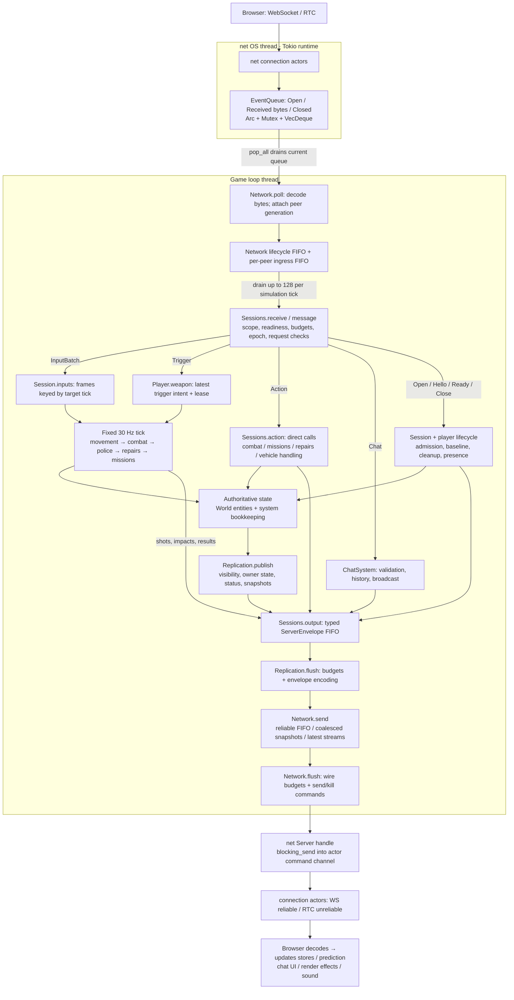
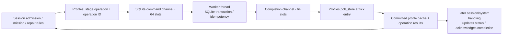

# Event dispatch, state changes and reactions

This describes the current checkout and the pinned `net` dependency at `a25516439f95d421d3dc752be1cbded8150c8805`. `net` exposes **two handles**: `EventQueue` for incoming notifications and `Server` for outgoing commands. There is no gameplay subscription registry or general event bus between systems.

## End-to-end flow



`main::run_loop` polls networking, advances the fixed-step scheduler, runs any due ticks, flushes networking and sleeps for 2ms. A networking poll is **not** a simulation tick: several polls may occur before a tick, or several catch-up ticks can follow one poll. No socket callback directly mutates `World`.

## What happens at each boundary

1. **Dependency queue.** The net connection actor translates reliable WebSocket application messages and RTC application messages into `ConnectionEvent::MessageReceived`. The server actor pushes `Event::Received(id, bytes)` into its shared queue. The game owns a clone of the same queue handle. `push` appends under the mutex; `pop_all` drains the buffer into an owned vector and releases the lock before gameplay runs. This queue has no explicit capacity bound. The net actor command channel and connection-event channel each have capacity 1024, but that does not bound the separate `EventQueue`.
2. **Transport adapter.** `Network.poll` consumes the raw events. Open creates a transport peer and a new generation; Closed removes it and queues a lifecycle event; Received is decoded/validated into `ClientEnvelope` and stored in that peer's ingress FIFO. Bad encodings and overflowing ingress mark the peer for closure. Received data has no reliable/unreliable channel metadata at this API boundary. `Open` represents the dependency's established connection, not a player who has joined gameplay.
3. **Session dispatcher.** `Sessions.receive` first polls persistence completions and drains up to 128 transport events. Closures in that batch are handled before messages. Lifecycle events are drained ahead of ingress messages; message draining makes one pass per peer at a time. The collected messages are then stably sorted by `PeerKey`, preserving FIFO within each peer. Arrival timing across peers is therefore not the final processing order.
4. **Authority checks.** `Sessions.message` validates protocol/world/session scope and applies ingress budgets. Each message variant has further rules: readiness for gameplay, control epoch, request ordering, rate limits, input tick windows or trigger sequence/lease rules. Rejected messages may be ignored, receive an error/result, or close the peer depending on the violation. A temporarily removed `Session` is passed to the handler and reinserted on success; handlers explicitly include this detached sender when broadcasting.
5. **Mutation and reaction.** Inputs are staged for later movement. Actions usually call a concrete method immediately during receive. Triggers store intent for the combat tick. Systems receive explicit mutable references and change entities or their own maps. Reactions between systems are ordinary calls—for example combat calls police crime reporting and population frighten—not dispatch of the original transport event to subscribers.
6. **Output.** `Replication::send/reliable` creates an envelope and appends it to `Sessions.output`; it does not send a socket packet immediately. `Replication.publish` also derives replication messages from current state. `Replication.flush` drains this outbox into the transport buffers. Finally `Network.flush` submits encoded bytes to the net `Server` handle, whose actor delivers them through the connection handles.

## Message routing and storage

| Input | Immediate handling | What remains stored / later work |
|---|---|---|
| `Open`, `ClientHello`, `ClientReady` | Create session; validate guest/build/content; allocate player after profile admission; baseline and readiness | `Sessions.peers`, session phase/epoch/visibility, `World.players`; asynchronous profile admission when SQLite is used |
| `InputBatch` | Check epoch/rate/tick bounds; keep the first frame for each accepted tick | `Session.inputs: BTreeMap<tick, InputFrame>`; movement removes the frame for the next tick, uses neutral input if absent, and discards obsolete frames |
| `Action` | Check readiness, request ID, epoch and rate; dispatch to combat, missions, repairs or vehicle logic | Result cache retains at most 32 action results; gameplay state changes immediately or an economic operation is staged; repeats reuse cached results |
| `Trigger` | Check rate, epoch, actor eligibility and monotonic trigger sequence | `Player.weapon.trigger` stores aim/intent with a 15-tick lease; combat schedules at most one automatic shot/player/tick according to weapon cooldown |
| `Chat` | ChatSystem validates/rate-limits text and reliably broadcasts a new chat line | Last 32 chat lines, last-send times and monotonic IDs; join/leave notices use the same history/output path |
| `Closed` / timeout / local rejection | Release player, vehicle occupancy, missions and police state; announce leave if the player had joined | Player/session removed; dependent system maps cleaned; transport kill may be queued; persistent profile remains |
| `Ping` | Queue a Pong; nonce convention selects response delivery | No gameplay state change; does not prove the ingress channel |
| `ResyncRequest` | Increase epoch, stop trigger/motion and send a fresh baseline | Inventory/world state retained; session visibility/input state reset as required; no new join announcement |

## Where state lives

| Owner | State | Lifetime |
|---|---|---|
| net `EventQueue` | Raw transport notifications containing IDs and bytes | Until the next `pop_all`; not an event log |
| `Network` | Peer generations, lifecycle/ingress queues and encoded delivery buffers | Connection / pending transmission |
| `Sessions` | Admission/readiness, scope/epoch, input frames, action-result cache, visibility, budgets and output | Session; not durable storage |
| `World` | Player characters, weapon inventory/timers, vehicles, collision/query world and tick | Authoritative running simulation |
| `Systems` | NPC populations, combat bookkeeping, police wanted/crime state, active missions, repair progress and chat history | Running simulation, with explicit lifecycle cleanup |
| `Profiles` + SQLite worker | Profile cache and in-flight operation/completion maps; SQLite profiles/economic records | Selected profile/economic state survives restart |
| Browser `GameSession` / replica / prediction stores | Received public/private samples, predicted local motor, event deduplication and UI state | Client connection; authoritative corrections come from server |

The raw event object is normally **consumed and discarded**. Its meaning is applied to state, or transformed into a new typed request/result/notification. This is not event sourcing: the server does not reconstruct the world by replaying a durable log of all incoming events.

## Actual tick order

```mermaid
flowchart LR
    A["Sessions.receive\nmessages/actions first"] --> B["Movement.prepare_tick\nconsume next-tick inputs; AI planning"]
    B --> C["Movement.update\nmotors, collision and vehicle impacts\nadvance world.tick"]
    C --> D["Combat.update\nautomatic shots, timers and lifecycle"]
    D --> E["Police.finish_tick"]
    E --> F["Disconnect failed movement peers"]
    F --> G["Repairs.update"]
    G --> H["Missions.update"]
    H --> I["Replication.publish"]
    I --> J["Replication.flush\napplication outbox → Network buffers"]
```



The ordering matters: a semi-auto `Fire` action runs during receive, before the next movement update. An automatic weapon stores trigger intent during receive and fires in the later combat update. Both use authoritative combat logic, but at different points in the tick. Population/police also participate through calls inside movement preparation/update; the diagram shows orchestration, not independent threads for each system.

## Concrete example: firing a shot

```mermaid
sequenceDiagram
    participant Q as net EventQueue
    participant N as Network
    participant S as Sessions
    participant C as CombatSystem
    participant W as World / player weapon
    participant Other as Population / Police
    participant R as Replication
    participant B as Browser
    Q->>N: Received(peer ID, encoded Fire action)
    N->>N: decode; enqueue ClientEnvelope
    S->>N: drain(128)
    N-->>S: Message(PeerKey, envelope)
    S->>S: scope, readiness, epoch, dedup, rate checks
    S->>C: weapon_action(Fire, mutable resources)
    C->>W: validate weapon/timers; spend ammo; update cooldown/bloom/sequence
    C->>W: collision ray + nearest eligible hit; apply permitted damage
    C->>Other: frighten / report_crime (direct calls)
    C->>R: queue Shot WorldEvent for relevant clients
    C-->>S: ActionCode
    S->>S: cache ActionResult by request ID
    S->>R: queue reliable ActionResult
    R->>R: publish owner/status/entity state from mutated stores
    R->>N: flush envelopes into delivery buffers
    N->>N: flush through net Server handle
    N-->>B: Shot + result + replicated state over WS/RTC
    B->>B: dedup event; effects/audio; reconcile state and ammo UI
```

`Shot` is a newly created outbound `WorldEvent`; it is not the incoming `net::Event` being forwarded. Damage/state changes are already applied on the server. The browser's Shot handler drives cosmetic effects and sound; replicated state updates the actual client view. Combat events use spatial relevance (192m) plus the explicit source; shots are reliable, whereas impact notifications to nearby recipients are unreliable. Other durable consequences—such as mission rewards—use the separate profile persistence path.

## Persistence is a separate command/completion loop



Only selected profile/economic changes take this route. Normal movement, shots, nametags and chat messages do not write a database row per event. The SQLite worker owns its database connection and communicates results back; it does not mutate live World entities from its worker thread.

## Queue limits and delivery implications

- Dependency EventQueue is an unbounded mutex-protected deque. Application caps do not retroactively bound allocations already made inside the dependency.
- Application transport admits at most 64 peers, with at most 128 pending lifecycle events. Per-peer ingress is capped at 32 action/trigger messages and 128 other/control messages. Invalid or overflowing peers are closed rather than letting gameplay queues expand without limit.
- Each peer's reliable output FIFO has a cap of 256 messages / 512 KiB. Overflow retires that peer; session/output byte budgets also apply.
- Unreliable entity snapshots coalesce by entity/visibility. Owner, Pong and cosmetic output use independent latest-message slots. These intentionally replace stale pending state rather than building a long backlog. Unreliable cosmetics can be dropped, so impacts are feedback rather than authoritative state storage.
- `Network.flush` submits at most 16 reliable messages per peer per pass, subject to wire budgets. The net Server handle uses `blocking_send`; a stalled dependency actor can still stall submission despite application queue bounds.
- `PeerKey` generations protect the application's queues and operations from reused numeric peer IDs. Raw dependency events carry numeric IDs only; generation checking does not add missing identity metadata inside that dependency.
- Cross-system reactions are visible in the call graph. There is no generic “publish Shot and every system reacts” mechanism: police/population receive explicit method calls, while clients receive the generated Shot notification through replication.

## Source map

- `crates/server/src/main.rs`: loop polling, scheduler and final network flush.
- `crates/server/src/transport.rs`: adapter events, generations, ingress/output buffers, poll/drain/send/flush.
- `crates/server/src/sessions/mod.rs`: session lifecycle, message match, staging and action dispatch.
- `crates/server/src/tick.rs`: fixed gameplay order.
- `crates/server/src/systems/mod.rs`: concrete system resources; no dynamic scheduler.
- `crates/server/src/systems/movement/mod.rs`: consumes tick-indexed inputs and writes authoritative motor state.
- `crates/server/src/systems/combat.rs`: direct mutations/reactions and new outbound WorldEvents.
- `crates/server/src/systems/chat.rs`: retained chat history, join/leave tracking and reliable broadcasts.
- `crates/server/src/replication/mod.rs`: envelope outbox, derived state publishing, visibility and budgets.
- `crates/server/src/admission.rs`, `persistence.rs`: profile cache, worker commands and completions.
- `apps/client/src/net/session.ts`, `world/replica.ts`: client message dispatch, event deduplication and replicated samples.
- Pinned net source: `src/queue.rs`, `src/server/mod.rs`, `src/server/connection.rs` in the Cargo git checkout for revision `a255164`.
