# Server module interactions

The diagram covers every Rust source module under `crates/server/src`, including module declaration files and the test-only police module. Solid arrows show principal calls, data access or ownership, with labels where useful. Dotted arrows show exports, declarations and test inclusion. Shared resource arguments and repeated `World`/`Sessions` borrows are omitted to keep the graph readable; this is an interaction map, not an exhaustive import graph. External crates (`protocol`, `content`, `sim-core`, `net`) are outside its scope.

`main.rs` creates the resources. `tick.rs` orders session input, AI preparation, movement, combat, police consequences, repairs, missions, replication and output. `systems/mod.rs` owns the concrete systems. World stores players and vehicles; PopulationSystem stores pedestrians; PoliceSystem owns wanted records and units; MissionSystem owns missions and recovery reservations; RepairSystem owns pending repairs. Weapons belong to player entities. Session lifecycle methods and replication publication/flushing take `&mut Systems` to keep their coordinator signatures compact. Individual systems borrow sibling fields separately to avoid borrowing their own parent twice. System methods still share mutable world/session resources, so these are not isolated subsystems.

```mermaid
flowchart TB
    main["main.rs: startup and game_loop"]
    lib["lib.rs: library exports"]
    config["config.rs"]
    loader["content_loader.rs"]
    control["control.rs: HTTP and metrics"]
    admission["admission.rs: Profiles and tickets"]
    persistence["persistence.rs: SQLite worker"]
    performance["performance.rs: timing histograms"]
    tick["tick.rs: ordered simulation tick"]
    sessions["sessions.rs: admission, input, actions"]
    transport["transport.rs: Network"]
    replication["replication.rs: visibility and output"]
    world["world.rs: players, vehicles, collision, content"]

    subgraph systems["systems/"]
        owners["mod.rs: Systems owns concrete systems"]
        movement["movement.rs: MovementSystem"]
        population["population.rs: PopulationSystem"]
        combat["combat.rs: CombatSystem"]
        police["police.rs: PoliceSystem"]
        missions["missions.rs: MissionSystem"]
        repairs["repairs.rs: RepairSystem"]
        police_tests["police_tests.rs: test-only child of police"]
    end
    subgraph entities["entities/"]
        entitymod["mod.rs: entity module declarations"]
        player["player.rs: Player"]
        vehicle["vehicle.rs: Vehicle and geometry"]
        pedestrian["pedestrian.rs: Pedestrian"]
        weapon["weapon.rs: Weapon"]
    end

    main -. "uses library" .-> lib
    main --> config & loader & control & transport & tick
    main -->|constructs| world & sessions & owners
    lib -. exports .-> config & loader & control & admission & persistence & performance & tick & sessions & transport & replication & world & owners & entitymod
    config -->|creates Profiles| admission
    loader -->|WorldContent| world
    control -->|guest and ticket requests| admission
    control -->|reads status and metrics| world & sessions & owners & performance
    admission -->|commands and committed results| persistence
    tick -->|receive, simulate, publish, flush| sessions & movement & combat & police & repairs & missions & replication
    tick -->|timings| performance
    sessions -->|drain input| transport
    sessions -->|join and disconnect| admission
    sessions -->|dispatch actions and cleanup| combat & police & missions & repairs & population
    sessions -->|control transitions and baselines| replication
    replication -->|send queued output| transport
    transport -->|budget and snapshot buffer helpers| replication
    replication -->|reads entities and private status| world & population & police & missions
    movement -->|AI decisions and impacts| population & police & combat
    combat -->|crime observations| police
    combat -->|pedestrian damage and fear| population
    combat -->|fail missions on death| missions
    police -->|shared navigation and safe spawn queries| population & combat
    police -->|fail missions on arrest| missions
    missions -->|reserve or retire vehicles| world & population & police & combat
    missions -->|avoid overlapping repair transactions| repairs
    repairs -->|check pending mission rewards| missions
    repairs -->|check wanted state| police
    missions -->|committed rewards| admission
    repairs -->|debits and refunds| admission
    owners -->|owns instances| movement & population & combat & police & missions & repairs
    world -->|stores| player & vehicle
    population -->|stores| pedestrian
    player -->|owns equipment| weapon
    pedestrian -->|uses PedestrianPhase| population
    entitymod -. declares .-> player & vehicle & pedestrian & weapon
    police -. "test module" .-> police_tests
    police_tests -. exercises .-> police & world & owners
```

